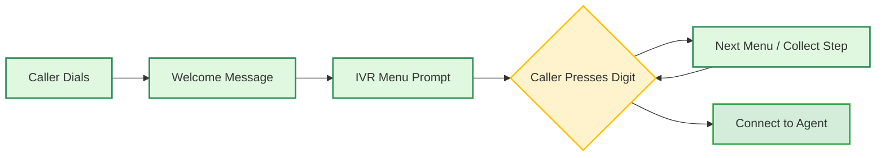

# Packet: Ep 25 IVR Menus and DTMF Keypad Input

## DTMF (keypad input) (inbound/dtmf)

Let callers enter digits on their phone keypad and have your voice agent respond to the input.

## What is DTMF?

DTMF (Dual-Tone Multi-Frequency) is the system behind phone keypad input: the tones produced when a caller presses a digit key (0-9, `*`, `#`).

When enabled, digit presses from the caller are captured and sent to the agent as a text message, which the LLM can read and respond to just like spoken input.

## When to use it

DTMF is useful any time you want callers to enter structured numeric input without speaking it:

* **PIN or OTP verification** -- "Please enter your 6-digit OTP followed by #"
* **Account or order number lookup** -- "Enter your account number and press #"
* **Phone number capture** -- collecting a callback number during a call
* **Confirmation flows** -- "Press 1 to confirm, 2 to cancel"
* **Sensitive input** -- when callers are uncomfortable speaking a number aloud (e.g. a password or card number)

DTMF works alongside speech. A caller can still speak normally between keypad entries.

  For branching menu flows ("press 1 for sales, press 2 for support"), use [IVR Inbound Calls](/docs/inbound/ivr) instead. It handles menu routing natively without an LLM.

## Telephony support

| Provider | Support |
| - | - |
| Plivo | Supported |
| Twilio | Supported |
| SIP Trunk (BYOT) | Currently not supported |
| Exotel | Currently not supported |
| Vobiz | Currently not supported |

## Enabling DTMF

### From the dashboard

Toggle on **Keypad Input (DTMF)** in the **Calling Tab** of your agent.

### Via the API

Set `dtmf_enabled: true` inside `task_config` when creating or updating an agent:

```json theme={"system"}
{
  "task_config": {
    "dtmf_enabled": true
  }
}
```

## How it works

1. The agent asks the caller to enter digits and press `#`.
2. The caller presses keys on their keypad.
3. Bolna accumulates the digits until `#` is pressed.
4. The digits are delivered to the agent as: `dtmf_number: <digits>`
5. The agent responds to the input.

  `#` is the termination key. The agent only receives the input after the caller presses it. The `#` itself is not included in the value.

## Writing the prompt

Tell callers to press `#` after their entry, and tell the agent what to do when it sees a `dtmf_number:` message.

**Example prompt snippet:**

```
When you need the caller's phone number, say:
"Please enter your phone number on your keypad and press the hash key when you are done."

When you receive a message starting with "dtmf_number:", the digits that follow are what the caller entered.
Read them back to confirm and proceed accordingly.
```

**What the agent receives:**

```
dtmf_number: 9876543210
```

The agent treats this like any other message in the conversation. It can confirm the value, use it in a tool call, or move to the next step based on it.

## Next steps

**IVR inbound calls**:
    Menu-based call routing with keypad navigation

**Calling tab**:
    All call configuration options

## Set up IVR for inbound calls in Bolna voice AI (inbound/ivr)

Configure IVR menus to route inbound calls to different Bolna Voice AI agents. Support department routing, language selection, and data collection.

## What is IVR?

IVR (Interactive Voice Response) lets callers navigate menus using their phone keypad before connecting to a Voice AI agent.

**Route by department**:
    Send callers to Sales, Support, or Billing agents automatically

**Collect information**:
    Gather account numbers, PINs, or preferences before the conversation

**Multi-language support**:
    Let callers choose their preferred language before connecting

  IVR is currently supported for **Plivo** phone numbers only.

## How IVR works



All collected data (department choice, account number, etc.) is passed to the agent as context.

## Setting up IVR via API

Add `ivr_config` to the [Set Inbound Agent API](/docs/api-reference/inbound/agent):

  ```bash request theme={"system"}
  curl -X POST "https://api.bolna.ai/inbound/setup" \
    -H "Authorization: Bearer <token>" \
    -H "Content-Type: application/json" \
    -d '{
      "agent_id": "your-default-agent-id",
      "phone_number_id": "your-phone-number-id",
      "ivr_config": {
        "enabled": true,
        "voice": "Polly.Aditi",
        "welcome_message": "Welcome to Acme Corp.",
        "steps": [
          {
            "step_id": "main_menu",
            "type": "menu",
            "prompt": "Press 1 for Sales. Press 2 for Support.",
            "field_name": "department",
            "options": [
              {"digit": "1", "label": "Sales", "agent_id": "sales-agent-id"},
              {"digit": "2", "label": "Support", "agent_id": "support-agent-id"}
            ]
          }
        ]
      }
    }'
  ```

  ```json response theme={"system"}
  {
    "message": "Phone number is already mapped to the given agent. IVR config updated."
  }
  ```

## IVR configuration reference

### Top-level config

| Field | Type | Default | Description |
| - | - | - | - |
| `enabled` | boolean | `false` | Enable or disable IVR |
| `voice` | string | `Polly.Joanna` | Text-to-speech voice for IVR prompts |
| `welcome_message` | string | - | Played once when the call connects |
| `timeout` | integer | `5` | Seconds to wait for caller input |
| `max_retries` | integer | `2` | Retry count on invalid input |
| `invalid_input_message` | string | `Invalid input. Please try again.` | Played on wrong key press |
| `no_input_message` | string | `No input received. Goodbye.` | Played on timeout |
| `steps` | array | **required** | IVR flow steps (see below) |
| `default_agent_id` | string | - | Fallback agent when no option-level agent is set |

### Available voices

| Voice | Language |
| - | - |
| `Polly.Aditi` | Hindi + Indian English |
| `Polly.Raveena` | Indian English |
| `Polly.Joanna` | US English (Female) |
| `Polly.Matthew` | US English (Male) |
| `Polly.Amy` | British English (Female) |

## Step types

**Menu Step**:
    Presents options for the caller to select using the keypad.

    ```json theme={"system"}
    {
      "step_id": "department",
      "type": "menu",
      "prompt": "Press 1 for Sales. Press 2 for Support.",
      "field_name": "department",
      "options": [
        {"digit": "1", "label": "Sales", "agent_id": "sales-agent-id"},
        {"digit": "2", "label": "Support", "agent_id": "support-agent-id"}
      ]
    }
    ```

    **Option Fields:**

    | Field | Type | Required | Description |
    | - | - | - | - |
    | `digit` | string | Yes | Key to press (`"1"`, `"2"`, etc.) |
    | `label` | string | Yes | Value stored in collected data |
    | `agent_id` | string | No | Route to a specific agent |
    | `context_label` | string | No | Additional context passed to agent |

**Collect Step**:
    Collects multi-digit input like account numbers or PINs.

    ```json theme={"system"}
    {
      "step_id": "account",
      "type": "collect",
      "prompt": "Enter your 6-digit account number.",
      "field_name": "account_number",
      "num_digits": 6,
      "next_step": "pin_step"
    }
    ```

    **Collect Fields:**

    | Field | Type | Description |
    | - | - | - |
    | `num_digits` | integer | Exact number of digits required |
    | `min_digits` | integer | Minimum digits (if `num_digits` not set) |
    | `max_digits` | integer | Maximum digits (if `num_digits` not set) |
    | `finish_on_key` | string | Submit key (default: `#`) |

## Step navigation

Control flow between steps:

| Field | Usage | Description |
| - | - | - |
| `next_step` | Linear flow | Go to specified step after this one |
| `conditional_next` | Branching | Route based on digit: `{"1": "step_a", "2": "step_b"}` |
| *(neither)* | End flow | Routes to the assigned agent |

  Use `conditional_next` for language selection or department-specific sub-menus. Combine with `next_step` for sequential data collection.

## Data passed to agent

All collected IVR data is available in `recipient_data`:

```json theme={"system"}
{
  "department": "Sales",
  "department_context": "sales_inquiry",
  "account_number": "123456",
  "ivr_completed_at": "2026-01-15T10:30:00Z"
}
```

Reference these in your agent prompt:

```
Customer selected {{department}}. Account: {{account_number}}
```

  Learn more about using dynamic variables in [Using Context](/docs/prompting/using-context).

## Examples

**Simple Department Routing**:
    Route calls to different agents based on selection:

    ```json theme={"system"}
    {
      "ivr_config": {
        "enabled": true,
        "voice": "Polly.Aditi",
        "welcome_message": "Welcome to Acme Corp.",
        "steps": [
          {
            "step_id": "department",
            "type": "menu",
            "prompt": "Press 1 for Sales. Press 2 for Support. Press 3 for Billing.",
            "field_name": "department",
            "options": [
              {"digit": "1", "label": "Sales", "agent_id": "sales-agent-uuid"},
              {"digit": "2", "label": "Support", "agent_id": "support-agent-uuid"},
              {"digit": "3", "label": "Billing", "agent_id": "billing-agent-uuid"}
            ]
          }
        ]
      }
    }
    ```

**Multi-Language with Branching**:
    Language selection followed by department menu:

    ```json theme={"system"}
    {
      "ivr_config": {
        "enabled": true,
        "voice": "Polly.Aditi",
        "welcome_message": "Welcome. Swagat hai.",
        "steps": [
          {
            "step_id": "language",
            "type": "menu",
            "prompt": "For English press 1. Hindi ke liye 2 dabayein.",
            "field_name": "language",
            "options": [
              {"digit": "1", "label": "English"},
              {"digit": "2", "label": "Hindi"}
            ],
            "conditional_next": {"1": "menu_en", "2": "menu_hi"}
          },
          {
            "step_id": "menu_en",
            "type": "menu",
            "prompt": "Press 1 for Sales. Press 2 for Support.",
            "field_name": "department",
            "options": [
              {"digit": "1", "label": "Sales", "agent_id": "english-sales-agent"},
              {"digit": "2", "label": "Support", "agent_id": "english-support-agent"}
            ]
          },
          {
   ...(code truncated)
    ```

**Account Verification Flow**:
    Collect account details before connecting to an agent:

    ```json theme={"system"}
    {
      "ivr_config": {
        "enabled": true,
        "voice": "Polly.Aditi",
        "welcome_message": "Welcome to your bank.",
        "default_agent_id": "bank-agent-uuid",
        "steps": [
          {
            "step_id": "account",
            "type": "collect",
            "prompt": "Please enter your 10-digit account number.",
            "field_name": "account_number",
            "num_digits": 10,
            "next_step": "pin"
          },
          {
            "step_id": "pin",
            "type": "collect",
            "prompt": "Enter your 4-digit PIN.",
            "field_name": "pin",
            "num_digits": 4
          }
        ]
      }
    }
    ```

## Disable IVR

To disable IVR and route calls directly to your agent:

```bash theme={"system"}
curl -X POST "https://api.bolna.ai/inbound/setup" \
  -H "Authorization: Bearer <token>" \
  -H "Content-Type: application/json" \
  -d '{
    "agent_id": "your-agent-id",
    "phone_number_id": "your-phone-number-id",
    "ivr_config": {"enabled": false}
  }'
```

## Next steps

**Inbound call setup**:
    Basic inbound calling configuration

**Connect Plivo**:
    Use your own Plivo phone numbers

**Using context**:
    Pass dynamic data to your agents

