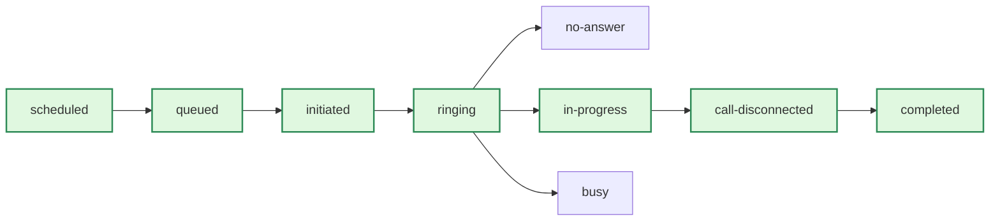

# Packet: Ep 28 Call Statuses, Failed Calls and Auto-Retry

## Auto-retry for failed calls (outbound/auto-retry)

Automatically retry calls that fail due to no-answer, busy signals, or errors to improve contact rates.

## What is Auto-retry?

Auto-retry automatically reschedules calls that fail to connect. When a call ends with statuses like `no-answer` or `busy`, Bolna retries the call after a configurable delay, improving your overall contact rates without manual intervention.

## How to enable Auto-retry

Add the `retry_config` object when making a call via the [Make Call API](/docs/api-reference/calls/make) or [Create Batch API](/docs/api-reference/batches/create).

  ```bash Single Call theme={"system"}
  curl -X POST 'https://api.bolna.ai/call' \
  -H 'Authorization: Bearer <api_key>' \
  -H 'Content-Type: application/json' \
  -d '{
    "agent_id": "your-agent-id",
    "recipient_phone_number": "+1234567890",
    "retry_config": {
      "enabled": true,
      "max_retries": 3,
      "retry_on_statuses": ["no-answer", "busy", "failed"],
      "retry_intervals_minutes": [30, 60, 120]
    }
  }'
  ```

  ```bash Batch Call theme={"system"}
  curl -X POST 'https://api.bolna.ai/batches' \
  -H 'Authorization: Bearer <api_key>' \
  -F 'agent_id=your-agent-id' \
  -F 'file=@contacts.csv' \
  -F 'retry_config={"enabled":true,"max_retries":2,"retry_intervals_minutes":[15,30],"prioritize_retries":true}'
  ```

## Configuration options

| Parameter | Type | Default | Description |
| - | - | - | - |
| `enabled` | boolean | `false` | Enable auto-retry |
| `max_retries` | integer | `3` | Maximum retry attempts (1–3) |
| `retry_on_statuses` | array | `["no-answer", "busy", "failed"]` | Statuses that trigger a retry |
| `retry_on_voicemail` | boolean | `false` | Retry if voicemail is detected |
| `retry_intervals_minutes` | array | `[30, 60, 120]` | Delay (in minutes) before each retry attempt |
| `prioritize_retries` | boolean | `false` | Place retries at the front of the dispatch queue once their delay elapses |

### Retry queue priority

By default a retry is queued behind the calls still waiting in its batch, so with a large batch the retry may only dial well after the configured delay has passed.

Set `prioritize_retries: true` to push the retry to the front of the queue as soon as its delay elapses, so it dials ahead of the remaining pending calls:

```json theme={"system"}
{
  "enabled": true,
  "max_retries": 3,
  "retry_intervals_minutes": [15, 30],
  "prioritize_retries": true
}
```

### Supported retry statuses

| Status | Description |
| - | - |
| `no-answer` | Call rang but was not answered |
| `busy` | Line was busy |
| `failed` | Call failed to connect |
| `error` | Technical error occurred |

## Monitoring retries via webhook

When auto-retry is configured, your webhook receives retry information with each status update:

```json theme={"system"}
{
  "id": "execution-id",
  "status": "scheduled",
  "retry_count": 1,
  "retry_config": {
    "enabled": true,
    "max_retries": 3
  },
  "retry_history": [
    {
      "attempt": 1,
      "status": "no-answer",
      "at": "2026-01-26T10:00:00Z"
    }
  ],
  "scheduled_at": "2026-01-26T10:30:00Z"
}
```

## Best practices

**Conservative intervals**:
    Start with 30+ minute intervals to avoid annoying contacts with rapid retries

**Skip voicemail retries**:
    Keep `retry_on_voicemail: false` (default) to avoid repeated voicemail deposits

**Monitor retry counts**:
    Track `retry_count` in webhooks to measure retry effectiveness over time

**Match urgency**:
    Use 1–2 retries for time-sensitive calls, 3 for lead outreach campaigns

## Related features

**Batch calling**:
    Run campaigns with thousands of contacts

**Webhooks**:
    Get real-time call status updates

**Call details**:
    View execution history and outcomes

## List of call hangup statuses and codes in Bolna voice AI (post-call/list-phone-call-hangup-status)

Explore all hangup statuses, provider codes, and termination reasons in Bolna Voice AI calls. Debug disconnections and improve reliability.

## Introduction

Every Bolna Voice AI call records metadata about how and why it was terminated. This data is essential for debugging, analytics, and improving call completion rates.

Each call termination includes three fields:

| Field | Description |
| - | - |
| `hangup_by` | Party or system that initiated the hangup (caller, callee, carrier, etc.) |
| `hangup_code` | Numeric code from the telecom provider indicating the specific reason |
| `hangup_reason` | Human-readable description of why the call ended |

## Why hangup codes matter

**Debug call issues**:
    Identify whether disconnections are user-initiated, carrier-caused, or system errors

**Monitor reliability**:
    Track telecom partner performance across providers like Twilio and Plivo

**Improve workflows**:
    Optimize call handling based on termination patterns and regional issues

**Regional insights**:
    Pinpoint geographic routing problems (US, India, Southeast Asia, MENA, etc.)

## Hangup status and provider codes

| Hangup By | Description | Provider Codes |
| - | - | - |
| **API Request** | Call ended via Bolna API request | `4000`, `4020` |
| **Callee** | Recipient hung up (outbound calls) | `3020`, `4000` |
| **Caller** | Caller ended the call (inbound calls) | `4000` |
| **Carrier** | Terminated by telecom carrier | `2000`, `3000`, `3010`, `3020`, `3040`, `3050`, `3070` |
| **Error** | Ended due to unexpected error | `3080`, `3090`, `3110`, `5010`, `5020`, `7011`, `8011` |
| **Plivo** | Plivo provider disconnected the call | `1010`, `4010`, `5020`, `6000`, `6010`, `6020` |
| **Unknown** | Termination reason unknown | `0` |
| *(empty)* | No hangup reason recorded | *(empty)* |

  Code `4000` appears across multiple categories (API, Caller, Callee). The correct interpretation depends on **call direction** (inbound vs outbound) and context.

## Hangup reasons

**Bolna-Side Reasons**:
    Bolna provides specific hangup reasons based on your agent configuration:

    | Reason | Description |
    | - | - |
    | `inactivity_timeout` | Call ended because the silence threshold was exceeded |
    | `llm_prompted_hangup` | Call ended based on custom prompt evaluation |

      Configure hangup prompts in the [Agent tab](/docs/agent-setup/agent-tab#hangup-using-prompt) and the inactivity timeout in the [Engine tab](/docs/agent-setup/engine-tab#final-call-message-%26-call-management) to control these behaviors.

**Telephony Provider Reasons**:
    Reasons provided by the telephony provider (Twilio, Plivo, etc.):

    | Reason | Description |
    | - | - |
    | `Call recipient was busy` | Called party was busy |
    | `Call unanswered` | Called party did not answer |
    | `Call recipient number invalid` | Invalid or unreachable phone number |
    | `Call recipient hung up` | Recipient ended the call |
    | `Carrier declined` | Call declined by carrier |
    | `Call recipient rejected` | Call rejected by the called party |
    | `failed` | Call could not be initiated |
    | `Carrier ended because call limit exceeded` | Call terminated due to duration limits |
    | `Bolna Error` | Error from Bolna system |
    | `Carrier unable to receive media` | Media connection issues |
    | `Network Congestion From Carrier` | Network congestion from carrier |
    | `End of inputs from Bolna` | Call ended after complete conversation (without prompt) |
    | `Carrier unable to reach bolna` | Carrier connectivity issue to Bolna |
    | `Carrier ended call because MPC duration limit exceeded` | Multi-party call duration limit reached |
    | `Telephony Internal Error` | Internal telephony system error |
    | `Carrier Internal Error` | Internal carrier error |
    | `Call completed` | Call completed successfully |
    | `Call canceled` | Call was canceled |
    | `Call ended` | Call terminated normally |
    | `Call timed out` | Call exceeded timeout limit |
    | `Unknown` | Unknown reason |

## Notes on code interpretation

**Multiple codes per status**:
    Multiple provider codes may map to a single `hangup_by` status depending on network or device behavior. Always check the `hangup_reason` field for additional context.

**Context-dependent codes**:
    Codes like `4000` appear in multiple categories. Interpretation depends on **call direction** (inbound vs outbound) and the `hangup_by` field.

**Regional carrier issues**:
    Frequent `3010` or `3050` codes in a specific region may indicate local routing or carrier coverage problems. Contact support if you notice persistent regional patterns.

## Related pages

**Call status list**:
    Track the full lifecycle of your calls

**Call latency metrics**:
    Analyze performance across the voice pipeline

**Get execution API**:
    Retrieve full execution details programmatically

## List of call statuses in Bolna voice AI (post-call/list-phone-call-status)

Understand every call status in Bolna Voice AI, from queued to completed. Track successful, unanswered, and failed call states.

## Introduction

Every Bolna Voice AI conversation carries two key fields throughout its lifecycle:

| Field | Purpose |
| - | - |
| `status` | Real-time status of the conversation |
| `error_message` | Explanatory message for errors or failed calls |

## Anatomy of a call

The following diagram shows how a call progresses from initiation to completion:



  `completed` is the **final** status of every conversation, indicating all post-call processing (recordings, data extraction) is finished.

## Call status reference

**Successful**:
    These statuses appear in chronological order during a normal call flow:

    | Status | Description |
    | - | - |
    | `scheduled` | Waiting for its `scheduled_at` time to elapse before being queued |
    | `queued` | Call received by Bolna and queued for processing |
    | `rescheduled` | Call triggered outside allowed hours and automatically rescheduled (requires [call guardrails](/docs/agent-setup/call-tab) configuration) |
    | `initiated` | Call initiated from Bolna's servers |
    | `ringing` | Call is ringing at the destination |
    | `in-progress` | Call answered and conversation is active |
    | `call-disconnected` | Call has been disconnected |
    | `completed` | All post-call processing finished (recordings, data extraction; may take \~2-3 minutes after disconnect) |

**Unanswered**:
    | Status | Description |
    | - | - |
    | `balance-low` | Insufficient Bolna balance to initiate the call |
    | `busy` | Callee was busy |
    | `no-answer` | Phone rang but callee did not answer |

**Unsuccessful**:
    | Status | Description |
    | - | - |
    | `canceled` | Call was canceled |
    | `failed` | Call failed to connect |
    | `stopped` | Call stopped by user or due to no telephony provider response |
    | `error` | An error occurred while placing the call |

  The payloads for all status events follow the same structure as the [Get Execution API](/docs/api-reference/executions/get_execution) response.

## Example payload

**Completed call payload with &#x22;status&#x22; and &#x22;error_message&#x22;**:
  ```json {7, 8} theme={"system"}
  {
    "id": 7432382142914,
    "agent_id": "3c90c3cc-0d44-4b50-8888-8dd25736052a",
    "batch_id": "d12abbbe-d16d-4c51-b18c-c7d5c3807962",
    "conversation_duration": 123,
    "total_cost": 123,
    "status": "completed",
    "error_message": null,
    "answered_by_voice_mail": true,
    "transcript": "<string>",
    "created_at": "2024-01-23T01:14:37Z",
    "updated_at": "2024-01-29T18:31:22Z",
    "usage_breakdown": {
      "synthesizer_characters": 123,
      "synthesizer_model": "polly",
      "transcriber_duration": 123,
      "transcriber_model": "deepgram",
      "llm_tokens": 123,
      "llm_model": {
        "gpt-3.5-turbo-16k": {
          "output": 28,
          "input": 1826
        },
        "gpt-3.5-standard-8k": {
          "output": 20,
          "input": 1234
        }
      }
   ...(code truncated)
  ```

## Related pages

**Hangup status codes**:
    Understand who ended the call and why

**Call latency metrics**:
    Analyze performance across the voice pipeline

**Get execution API**:
    Retrieve full execution details programmatically

## Handle failures and retries at scale (production/failures-and-retries-at-scale)

Run large Bolna Voice AI campaigns: classify failures by status, set retry policy, respect guardrails and concurrency, and monitor batches efficiently.

At a few calls a day, failures are anecdotes. At tens of thousands, they are a distribution you have to manage. This page is the operational view; the diagnostic view is [Calls fail or drop early](/docs/troubleshooting/calls-fail-or-drop-early).

## Classify before you retry

Not every non-success is retryable.

| Class | Statuses | Action |
| - | - | - |
| **Retryable** | `no-answer`, `busy` | Retry on a schedule — the contact exists and was unavailable |
| **Sometimes retryable** | `failed`, `error`, `stopped` | Retry once, then quarantine. Repeats point at a provider or number problem |
| **Never retry** | `balance-low` | Fix the wallet. Retrying burns the queue against a hard stop |
| **Not a failure** | `rescheduled` | Guardrails deferred the call to your allowed window |
| **Completed but unsuccessful** | `completed` with a negative outcome | A business problem, not a delivery problem — handle it in [extractions](/docs/prompting/using-extractions) and dispositions |

## Configure retries once, in the call

Set `retry_config` on the [Make call API](/docs/api-reference/calls/make) or the [Create batch API](/docs/api-reference/batches/create) rather than rebuilding retry logic in your own scheduler:

```json theme={"system"}
{
  "retry_config": {
    "enabled": true,
    "max_retries": 3,
    "retry_on_statuses": ["no-answer", "busy", "failed"],
    "retry_intervals_minutes": [30, 60, 120]
  }
}
```

Widening intervals is deliberate: three attempts inside ten minutes annoy the same unavailable person, while 30/60/120 minutes samples different parts of their day. See [Retry calls that did not connect](/docs/outbound/auto-retry) for every option, including prioritizing retries ahead of fresh contacts.

  Retries consume concurrency and wallet balance like any other call. A campaign sized for 5,000 contacts with three retries each must be planned as up to 20,000 calls.

## Respect the two limits that bite at scale

**Concurrency**:
    Your account has a floor and, optionally, a ceiling on simultaneous calls. Sub-accounts share one organization envelope, so one team's campaign can starve another's unless minimums are set.

**Calling hours**:
    Guardrails evaluate the **recipient's** local time. A campaign spanning several countries will legitimately reschedule large portions of itself.

Also mind [API rate limits](/docs/api-reference/rate-limiting) when enqueuing: submit a [batch](/docs/outbound/batch-calling) rather than thousands of individual `POST /call` requests.

## Monitor without polling everything

* Take results from **webhooks** as the primary channel — [Get results with webhooks](/docs/post-call/polling-call-status-webhooks) — and poll only for executions you never heard about.
* For a batch, read [`GET /batches/{batch_id}/executions`](/docs/api-reference/batches/executions) rather than fetching each execution individually. It returns a bare array.
* Treat only terminal statuses as final: `completed`, `no-answer`, `busy`, `failed`, `canceled`, `stopped`, `error`, `balance-low`.
* Watch the mix, not the total. A rising share of `failed` in one country is a carrier incident; a rising share of `no-answer` across the board usually means the calling window drifted.

## Before the next big campaign

**Readiness checklist**:
    Pre-launch verification

**Control cost per call**:
    Retries multiply spend

**Call a contact list in bulk**:
    How batches work

## Calls fail to connect or drop early (troubleshooting/calls-fail-or-drop-early)

Diagnose Bolna Voice AI calls that never connect or end too soon, using call statuses, hangup codes, balance and guardrail checks, and silence-based termination settings.

Start from the call's own record. Every execution carries a `status`, and every terminated call carries `hangup_by`, `hangup_code` and `hangup_reason` — those four fields identify the cause faster than any amount of re-testing.

**Read the status**:
    Open the call in [Call history](/docs/agent-setup/call-history), or fetch it with [`GET /executions/{id}`](/docs/api-reference/executions/get_execution). Match the value against [Call statuses](/docs/post-call/list-phone-call-status).

**Read the hangup fields**:
    For calls that connected and then ended, `hangup_by` tells you whether the caller, the agent, or the carrier ended it. Look the code up in [Hangup codes](/docs/post-call/list-phone-call-hangup-status).

## The call never connects

| Status | What it means | What to do |
| - | - | - |
| `balance-low` | Not enough wallet balance to place the call | Top up. Monitor balance before large batches — see [Handle failures and retries at scale](/docs/production/failures-and-retries-at-scale). |
| `rescheduled` | Triggered outside your allowed calling window | Expected behavior if [calling guardrails](/docs/outbound/calling-guardrails) are on. The window is evaluated in the **recipient's** timezone. |
| `no-answer` / `busy` | The far end did not pick up | Not a fault. Enable [auto-retry](/docs/outbound/auto-retry) rather than re-triggering manually. |
| `failed` / `error` | The call could not be placed | Check `error_message`, then the number format (E.164, with country code) and the telephony provider connection. |
| `stopped` | Stopped by a user, or no response from the telephony provider | If you did not stop it, treat it as a provider-side failure and check the provider's own logs. |

  A call scheduled through the API must be at least **two minutes** in the future and use a numeric UTC offset such as `+00:00`. A `Z` suffix is rejected. See [Schedule a batch](/docs/api-reference/batches/schedule).

## The call connects, then ends too soon

**Silence-based hangup**:
    The agent hangs up after a configured period of silence. If callers are being cut off while thinking, raise that limit — see [End a call automatically](/docs/outbound/hangup-calls).

**Maximum call duration**:
    `call_terminate` caps total call length. Long support calls hitting a short cap look exactly like a drop.

**Voicemail detection**:
    With detection on, a call answered by voicemail is ended deliberately. Check the [Call tab](/docs/agent-setup/call-tab) if legitimate answers are being dropped.

**Carrier disconnect**:
    `hangup_by` pointing at the carrier, especially in one region, is a routing problem, not an agent problem.

## When it is only some calls

Pull a batch of executions with [`GET /v2/agent/{agent_id}/executions`](/docs/api-reference/executions/get_executions) and group failures by status, destination country and telephony provider. A failure concentrated in one country or one provider is a telephony issue; a failure spread evenly is a configuration issue.

## Next steps

**Call statuses**:
    Every status, explained

**Hangup codes**:
    Why the call ended

**Retry failed calls**:
    Automatic retries

