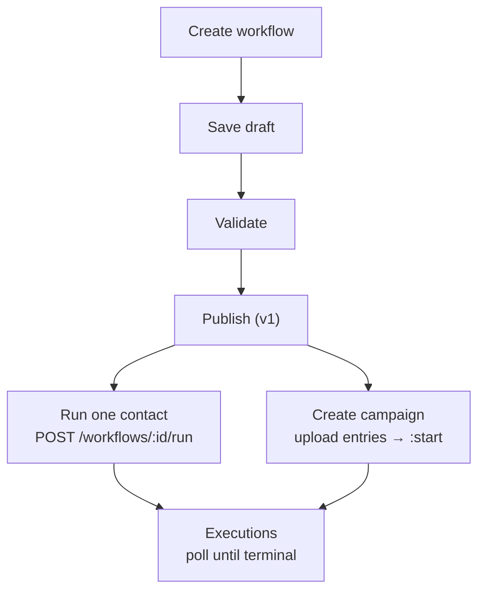

# Packet: Ep 46 Workflows (Beta), Campaigns and WhatsApp via AiSensy

## Graph agents vs workflows: which one to use (graph-agent/graph-agents-vs-workflows)

Graph agents control what happens inside a single conversation; workflows orchestrate steps across calls and channels. Pick the right Bolna builder.

Bolna has two visual builders, and they solve different problems.

**Graph agents**:
    Control **what happens inside one conversation**. Nodes are conversation states; transitions decide when the caller moves between them.

**Workflows (beta)**:
    Orchestrate **a sequence of steps around calls** — run a call, branch on the result, wait, message, call again.

## Choosing

| If you need to | Use |
| - | - |
| Force the agent through verification before it discloses anything | Graph agent |
| Ask a fixed question set and refuse to skip ahead | Graph agent |
| Route to different scripts based on what the caller says | Graph agent |
| Inject a real-time event mid-call | Graph agent ([event injection](/docs/graph-agent/event-injection)) |
| Retry tomorrow if nobody answered | Workflow |
| Send a WhatsApp message after a call ends | Workflow ([AiSensy](/docs/workflows/aisensy-whatsapp)) |
| Run a multi-step outreach campaign over days | Workflow ([campaigns](/docs/workflows/campaigns)) |
| Neither — one prompt handles the conversation | Neither. Use a [standard agent](/docs/agent-setup/overview) |

  They compose. A workflow step can run a graph agent, so a strict in-call script and a multi-day sequence are not competing choices.

## A rule of thumb

Ask where the branching lives.

* Branching **inside the call**, decided by what the caller says → graph agent.
* Branching **between calls**, decided by the call outcome → workflow.
* Branching only in your own backend, because you already have an orchestrator → neither. Use a standard agent and drive it from the [API](/docs/api-reference/introduction).

## Cost of each choice

A graph agent adds design work up front and makes behavior predictable and testable — see [testing](/docs/graph-agent/testing) and [validation](/docs/graph-agent/validation). Workflows are in **beta**: the builder, the [API surface](/docs/api-reference/workflows/overview) and campaign behavior are still changing, so prefer them for internal or lower-risk sequences until they are generally available.

## Next steps

**Build a graph agent**:
    Nodes, transitions, routing

**Build a workflow**:
    Steps, conditions, campaigns

**Just use one prompt**:
    The simplest option that works

## AiSensy WhatsApp integration (workflows/aisensy-whatsapp)

Connect your AiSensy account to a Bolna workflow so any step can send an approved WhatsApp template, then create and test a campaign in AiSensy if you need one.

  Connect your AiSensy account to Bolna once, then send approved WhatsApp templates from any step of a workflow — no separate WhatsApp setup, no code.

## What is AiSensy?

AiSensy is a WhatsApp Business API platform. It sits between your business and Meta's official WhatsApp Business API — handling business verification, the approved sender number, template management, and message delivery, so you don't have to build against Meta's API yourself.

The pieces of AiSensy that matter for this integration:

* **Project** — your AiSensy workspace. Each project has its own WhatsApp Business number and its own API key.
* **Template** — a pre-written message format that Meta reviews and approves. On WhatsApp, business-initiated messages *must* use an approved template.
* **Campaign** — a launched instance of a template. This is what you actually select inside Bolna.

## How AiSensy is integrated into Bolna

AiSensy is integrated directly into Bolna [workflows](/docs/workflows/introduction). You paste your AiSensy **project API key** and **project ID** into Bolna once for authentication, and Bolna pulls in the list of WhatsApp campaigns running under that project. You pick a campaign, drop it into a workflow as an [`aisensy_whatsapp` node](/docs/workflows/nodes#aisensy_whatsapp), and Bolna sends that template on your behalf when the workflow reaches that step.

That means a single workflow can mix voice and WhatsApp — for example, calling a lead, extracting how the conversation went, branching on the result, and following up hot leads on WhatsApp while the cold ones just end.

## Before you start

| You need | Where it comes from |
| - | - |
| An AiSensy account with an active project | [aisensy.com](https://www.aisensy.com) |
| A WhatsApp Business number connected to that project | Set up during AiSensy onboarding |
| At least one Meta-approved template, launched as a campaign | See [Create a campaign in AiSensy](#don%E2%80%99t-have-a-campaign-yet-create-one-in-aisensy) below — you can create one from scratch |
| A Bolna workflow (a draft is fine) | Bolna dashboard → Workflows |

## How to send a WhatsApp message in a Bolna workflow

**Authenticate with your AiSensy project API key**:
    1. In AiSensy, open the project you want to send from.
    2. Go to **Developer** → **Project API Keys**.

    3. Copy the **project API key**.
    4. In Bolna, open your workflow, add the **AiSensy WhatsApp** node, and paste the key and project ID, then click **Link AiSensy account**.

      The API key is scoped to one AiSensy project. If you run multiple projects (different numbers or brands), use the key for the project whose number should appear as the sender.

      You can also link the account outside a workflow, from **Integrations** in the Bolna dashboard, or by opening [platform.bolna.ai/auth/aisensy](https://platform.bolna.ai/auth/aisensy) — which signs you in and takes you straight to the AiSensy card. Either route stores the same credentials on your account, so a workflow node linked one way is already connected the other.

**Select your campaign and send a test message**:
    Once the key is accepted, Bolna fetches every campaign running under that project and shows them as a list.

    1. Select the campaign you want to use.
    2. Fill in any template variables (name, order ID, date — whatever your template uses). You can also use workflow fields as message variables.
    3. Send a test message to fire it to your own number and confirm the sender, wording, and variables all look right.

      Always send a test before publishing. It's the fastest way to catch a wrong variable order or a template that reads oddly once the placeholders are filled in.

## Don't have a campaign yet? create one in AiSensy

A campaign needs an approved template first. Templates are reviewed by Meta, so budget time for this — approval is usually quick but not instant.

### Create the WhatsApp template

**Open Template Messages**:
    1. Log in to the AiSensy project the campaign should live under.
    2. From the left nav, select **Manage** (the gear icon), then **Template Message**.

**Create and submit the template**:
    Click **Create Template** in the top right, build your WhatsApp template following the on-screen instructions, then submit it for Meta review.

    Your submitted template appears under the **All** tab in the same section, with its current status.

### Launch the campaign

**Start a new campaign**:
    Once the template status turns **Approved**, go to **Campaigns** in the left nav, click **Launch** in the top right, then select **API Campaign**.

**Name it and set it live**:
    Give the campaign a name, select the template you just created, then click **Set Live**.

**Verify it end-to-end**:
    Use the **Test** option on the live campaign to confirm delivery before wiring it into a workflow.

**Pick it up in Bolna**:
    Head back to Bolna and refresh the campaign list — the new campaign is now selectable from the AiSensy WhatsApp node.

## For developers: the `aisensy_whatsapp` node

If you're building workflows through the Bolna API rather than the dashboard, the node type is `aisensy_whatsapp`. Its config fields (`template_name`, `language`, `recipient`, `variables`, `campaign_name`) and a full JSON example are documented in [Workflow Nodes](/docs/workflows/nodes#aisensy_whatsapp) — including a note that the node is fire-and-forget for now, so there's no delivery status to branch on yet.

## Debugging tips

| Symptom | What to check |
| - | - |
| Meta rejected my template | Review the rejection reason and resubmit — AiSensy's help center documents the approval process in detail |
| Not sure what's allowed in a template | Check AiSensy's template content guidelines before writing, not after |
| Message fails to send with an API error | Look up the error code in AiSensy's API error reference |
| Campaign list is empty in Bolna | Confirm the API key belongs to the right project, and that the project has at least one *launched* campaign — approved templates alone won't appear |
| Test message sends, live workflow doesn't | Check the recipient variable is populated for that contact, and that the number is in international format |
| Message sends but variables are blank or shifted | Template placeholders are positional and must be contiguous from `1`. A missing `"2"` shifts everything after it |

## Workflow campaigns (workflows/campaigns)

Run a published workflow over thousands of contacts: create a campaign, upload entries as CSV or JSON, start it, and track progress with per-node reports.

## What is a workflow campaign?

A campaign runs one published workflow version over a batch of contacts. Where the [run endpoint](/docs/api-reference/workflows/run) handles one contact per request, a campaign takes uploads of up to 150,000 rows and turns each accepted row into an execution when started.

Two things are fixed at creation time:

* **The version pin.** Passing `"version": null` pins the latest published version *at that moment*; publishing newer versions later never changes a created campaign.
* **The entry schema.** Uploads are validated against the pinned version's start-node fields.

The lifecycle is `draft` → `scheduled` → `running` → (`paused` ↔ `running`) → `completed` or `aborted`.

## Running a campaign

**Create the campaign**:
    Use the [Create Campaign API](/docs/api-reference/workflow-campaigns/create) with the workflow to run:

      ```bash request theme={"system"}
      curl --location 'https://api.bolna.ai/workflow-campaigns' \
      --header 'Authorization: Bearer <api_key>' \
      --header 'Content-Type: application/json' \
      --data '{
        "workflow_id": "1f2a3b4c-5d6e-7f80-91a2-b3c4d5e6f708",
        "version": null,
        "name": "August loan follow-ups"
      }'
      ```

      ```json response theme={"system"}
      {
        "id": "7c1d2e3f-4a5b-6c7d-8e9f-0a1b2c3d4e5f",
        "name": "August loan follow-ups",
        "workflow_id": "1f2a3b4c-5d6e-7f80-91a2-b3c4d5e6f708",
        "workflow_version": 1,
        "kind": "batch",
        "status": "draft",
        "entries_count": 0,
        "success_count": 0,
        "failure_count": 0,
        "created_at": "2026-08-22T11:00:00Z",
        "updated_at": "2026-08-22T11:00:00Z"
      }
      ```

**Fetch the CSV template**:
    The [template endpoint](/docs/api-reference/workflow-campaigns/entries-template) returns the exact header row this campaign expects — the pinned version's declared fields in author order:

      ```bash request theme={"system"}
      curl --location 'https://api.bolna.ai/workflow-campaigns/7c1d2e3f-4a5b-6c7d-8e9f-0a1b2c3d4e5f/entries/template' \
      --header 'Authorization: Bearer <api_key>'
      ```

      ```csv response theme={"system"}
      mobile_number,loan_amount,city
      ```

**Upload entries**:
    Upload contacts with the [Upload Entries API](/docs/api-reference/workflow-campaigns/upload-entries) — as CSV or as a JSON array; the `Content-Type` header decides:

**CSV**:

          ```bash request theme={"system"}
          curl --location 'https://api.bolna.ai/workflow-campaigns/7c1d2e3f-4a5b-6c7d-8e9f-0a1b2c3d4e5f/entries' \
          --header 'Authorization: Bearer <api_key>' \
          --header 'Content-Type: text/csv' \
          --data-binary $'mobile_number,loan_amount,city\n+919876543210,60000,Pune\n+919876543211,not-a-number,Mumbai\n'
          ```

          ```json response theme={"system"}
          {
            "accepted": 1,
            "corrected": 0,
            "failed": 1,
            "entries_count": 1,
            "failures": [
              { "row": 3, "reference_id": null, "code": "invalid_field_type",
                "message": "loan_amount: expected number" }
            ],
            "warnings": []
          }
          ```

**JSON**:

          ```bash request theme={"system"}
          curl --location 'https://api.bolna.ai/workflow-campaigns/7c1d2e3f-4a5b-6c7d-8e9f-0a1b2c3d4e5f/entries' \
          --header 'Authorization: Bearer <api_key>' \
          --header 'Content-Type: application/json' \
          --data '[
            { "reference_id": "cand_101", "mobile_number": "+919876543210", "loan_amount": 60000, "city": "Pune" },
            { "reference_id": "cand_102", "mobile_number": "+919876543211", "loan_amount": 45000, "city": "Mumbai" }
          ]'
          ```

          ```json response theme={"system"}
          {
            "accepted": 2,
            "corrected": 0,
            "failed": 0,
            "entries_count": 3,
            "failures": [],
            "warnings": []
          }
          ```

    Validation runs in two stages. A whole-upload shape check first — an undeclared column rejects everything with `422 unknown_field`, a missing required column with `missing_required_field`, and nothing is persisted. Then rows are validated individually: failures are reported per row (`invalid_phone`, `invalid_field_type`, `missing_required_value`, `duplicate_reference_id`, ...) while good rows are accepted. For CSV, `row` counts the header as line 1, so the first data row is `2`.

      Fix-and-reupload just works: a row whose earlier version failed validation is replaced in place and counted in `corrected`. `reference_id` is each contact's identity — omit it and one is derived from the row's content, so identical rows deduplicate automatically.

**Start the campaign**:

      ```bash request theme={"system"}
      curl --location --request POST 'https://api.bolna.ai/workflow-campaigns/7c1d2e3f-4a5b-6c7d-8e9f-0a1b2c3d4e5f:start' \
      --header 'Authorization: Bearer <api_key>' \
      --header 'Content-Type: application/json' \
      --data '{}'
      ```

      ```json response theme={"system"}
      {
        "status": "scheduled"
      }
      ```

      If the pinned definition contains an agent node, starting the campaign places real calls to every pending entry.

    While it runs you can [pause](/docs/api-reference/workflow-campaigns/pause) (nothing new starts; timer waits hold), [resume](/docs/api-reference/workflow-campaigns/resume), or [abort](/docs/api-reference/workflow-campaigns/abort) (terminal — every execution stops before its next external action). A single contact can be stopped with the [Cancel Execution API](/docs/api-reference/workflow-executions/cancel).

**Monitor progress**:
    List executions as they progress, filtered by status or outcome:

      ```bash request theme={"system"}
      curl --location 'https://api.bolna.ai/workflow-campaigns/7c1d2e3f-4a5b-6c7d-8e9f-0a1b2c3d4e5f/executions?status=running&limit=50' \
      --header 'Authorization: Bearer <api_key>'
      ```

      ```json response theme={"system"}
      {
        "items": [
          {
            "id": "exec:7c1d2e3f-4a5b-6c7d-8e9f-0a1b2c3d4e5f:cand_101",
            "campaign_id": "7c1d2e3f-4a5b-6c7d-8e9f-0a1b2c3d4e5f",
            "status": "running",
            "current_node_id": "n_retry",
            "termination_reason": null,
            "outcome": null,
            "call_count": 1,
            "created_at": "2026-08-22T11:10:00Z",
            "updated_at": "2026-08-22T11:12:04Z"
          }
        ],
        "total": 1,
        "limit": 50,
        "offset": 0
      }
      ```

    And pull the aggregated [report](/docs/api-reference/workflow-campaigns/report) — the `termination_reasons` keys are your end nodes' labels, and `funnel` counts attempts per node of your definition:

      ```bash request theme={"system"}
      curl --location 'https://api.bolna.ai/workflow-campaigns/7c1d2e3f-4a5b-6c7d-8e9f-0a1b2c3d4e5f/report' \
      --header 'Authorization: Bearer <api_key>'
      ```

      ```json response theme={"system"}
      {
        "executions": { "completed": 240, "running": 12 },
        "termination_reasons": { "reached": 180, "unreachable": 60 },
        "funnel": [
          { "node_id": "n_call", "status": "completed", "count": 252 },
          { "node_id": "n_retry", "status": "completed", "count": 84 },
          { "node_id": "n_end_reached", "status": "completed", "count": 180 }
        ]
      }
      ```

## Next steps

**Workflow campaign APIs**:
    Every campaign endpoint in detail

**Workflow execution APIs**:
    Follow one contact node by node

**Quickstart**:
    Build and publish the workflow a campaign runs

**Batch calling**:
    Single-call batches, when you don't need a graph

## Workflow conditions and variables (workflows/conditions-and-variables)

The expression language behind workflow branching: cases, comparison operators, arithmetic, logical combinators, and the variable namespaces they read.

## Cases

Every branching node routes through an ordered list of cases. Each case pairs a condition (`when`) with a destination and optional effects (`then`):

```json theme={"system"}
"cases": [
  {
    "when": { "cmp": "==", "left": { "var": "call.status" }, "right": { "const": "completed" } },
    "then": {
      "to": "n_extract",
      "effects": [ { "set_value": { "state.attempted": { "const": true } } } ]
    }
  }
]
```

Cases are evaluated **in order and the first match wins**. When nothing matches, the execution moves to the node's `on_no_match`, or the definition-wide `on_no_match` if the node doesn't declare one — so an execution always has somewhere to go. Point the definition-wide fallback at a dedicated `end` node (an `unhandled` ending) and it doubles as your safety net.

## Operands

Conditions compare **operands**, each one of three forms:

| Form | Example | Meaning |
| - | - | - |
| `var` | `{"var": "extraction.call_score"}` | Reads a variable from the execution context |
| `const` | `{"const": 80}` | A literal — string, number, boolean, null, or (only as the right side of `in`) a list of up to 100 scalars |
| `op` | `{"op": "+", "args": [ ... ]}` | Arithmetic over other operands |

Arithmetic supports `+`, `-`, `*`, `/`. Addition and multiplication take any number of `args`; subtraction and division take exactly two:

```json theme={"system"}
{ "op": "+", "args": [ { "var": "extraction.call_score" }, { "var": "extraction.engagement_intent" } ] }
```

## Comparisons

```json theme={"system"}
{ "cmp": "in", "left": { "var": "call.status" }, "right": { "const": ["busy", "no_answer"] } }
```

| Operator | Meaning |
| - | - |
| `==`, `!=` | Equality. String comparison is case-insensitive by default; add `"cs": true` for case-sensitive |
| `>`, `>=`, `<`, `<=` | Numeric ordering — both sides must resolve to numbers |
| `in` | Left value is one of the right-side list's values |
| `contains` | Left string contains the right substring |

## Combinators

Combine conditions with `all` (AND), `any` (OR) and `not`, nested up to 32 levels:

```json theme={"system"}
{
  "all": [
    { "cmp": "==", "left": { "var": "response.status" }, "right": { "const": 200 } },
    { "any": [
      { "cmp": ">=", "left": { "var": "entry.loan_amount" }, "right": { "const": 50000 } },
      { "exists": { "var": "entry.priority_flag" } }
    ] }
  ]
}
```

Two more forms round out the language: `{"exists": {"var": "..."}}` is true when the variable is present, and `{"always": true}` matches unconditionally — the standard last case or single-exit route.

## Effects

A matching case can write to durable state before moving on:

```json theme={"system"}
"then": {
  "to": "n_api",
  "effects": [
    { "set_value": { "state.promised": { "var": "extraction.promised_date" } } }
  ]
}
```

`set_value` targets are always `state.<name>` (one level deep). `state.*` is the execution's scratchpad — it survives retries, later calls and waits, and is never reset.

## Variable namespaces

| Namespace | Written by | Reset | Contents |
| - | - | - | - |
| `entry.*` | contact ingress | never | The contact's fields — system fields plus everything the start node declares. `entry.reference_id` is always present |
| `call.*` | each `agent` node | overwritten per agent node | `call.status`, `call.duration_s`, `call.error`, plus post-call insights |
| `extraction.*` | `extraction` nodes | cleared on entering any agent node | The selected extracted fields from the latest call |
| `response.*` | each `api` node | cleared on entering any api node | `response.status`, `response.error`, plus every `response_map` name |
| `whatsapp.*` | each `aisensy_whatsapp` node | cleared on entering any WhatsApp node | Reserved (`whatsapp.status`, `whatsapp.message_id`, `whatsapp.error`) — not populated yet, see note |
| `state.*` | `set_value` effects | never | Your own durable values |
| `node.<id>.*` | every node | never | Per-node history — read an earlier node's outputs even after the live namespace was overwritten |

  `call.*` and `response.*` hold the **latest** node's values of that kind. When a workflow has two agent nodes and you need the first call's status after the second call ran, read it from `node.<first_node_id>.*` instead.

  `aisensy_whatsapp` is fire-and-forget for now — it doesn't wait on or surface AiSensy's delivery status, so `whatsapp.*` isn't actually populated. Don't branch on it; see [Workflow Nodes](/docs/workflows/nodes#aisensy_whatsapp).

## Variables in node configs

Node configs (agent prompt variables, API URLs/bodies, WhatsApp templates) don't embed expressions directly. They use `{placeholder}` references resolved by the node's `config.variables` map:

```json theme={"system"}
"config": {
  "url": "https://api.example.com/lookup",
  "body": { "phone": "{phone}" },
  "variables": {
    "phone": { "value": { "var": "entry.mobile_number" }, "required": true }
  }
}
```

Each variable spec takes a `value` operand, an optional `type` (one of `string`, `number`, `boolean`, `timestamp`, `phone`, `email`, `url`, `json` — the value is coerced, and the execution treats a failed coercion as a missing value), and `required`. A missing required variable stops the execution with `termination_reason` `required_variable_missing`; a missing optional one resolves empty and the execution continues with a `warning` event on its timeline.

## Next steps

**Nodes**:
    What each node writes and branches on

**Quickstart**:
    See conditions in a complete working definition

## Workflow execution webhook (workflows/execution-webhook)

Get a single POST to your server every time a workflow execution finishes, carrying the outcome and the full path the contact took through your workflow.

## What you get

Set a webhook URL on a workflow and Bolna sends your server **one request per execution**, at the moment that execution finishes. There is no request per node — the single payload carries the outcome plus the complete trail of every node the contact passed through, so you can reconstruct the whole journey without polling.

Every execution reports when it finishes, not just the ones that finish happily. A contact whose call never connected, a run you canceled, and a run still in flight when you aborted its campaign all send a webhook, with a `status` and `termination_reason` that tell you which. Contacts still waiting to start when a campaign is aborted never begin an execution, so they send nothing.

  This is separate from the [call status webhook](/docs/post-call/polling-call-status-webhooks), which fires per phone call. A workflow that places two calls sends two call webhooks and one execution webhook.

## Configuring it

The webhook lives in the workflow's `settings`, so it applies to every execution of the workflow, including ones already running.

**Dashboard**:
    Open the workflow in the editor and click the **Workflow settings** (gear) icon in the toolbar.

    1. Turn on **Send a webhook** and enter your endpoint in **Webhook URL**.
    2. To authenticate deliveries, turn on **Add headers** and enter them as a JSON object, e.g. `{"X-Api-Key": "your-receiver-token"}`. Saved values stay hidden as `**********`; leave the mask in place to keep a value.
    3. Click **Save**.

    Turning **Send a webhook** off and saving stops the webhook.

**API**:
    Set it with the [Update Workflow API](/docs/api-reference/workflows/update):

      ```bash request theme={"system"}
      curl -X PATCH https://api.bolna.ai/workflows/{workflow_id} \
        -H "Authorization: Bearer YOUR_API_KEY" \
        -H "Content-Type: application/json" \
        -d '{
              "settings": {
                "webhook": {
                  "url": "https://hooks.example.com/bolna/workflow",
                  "headers": {"X-Api-Key": "your-receiver-token"}
                }
              }
            }'
      ```

Setting a URL is what turns the webhook on. `headers` are sent with every delivery and are the usual way to authenticate the request as genuinely from Bolna.

A few rules the URL has to satisfy:

* **`https` only**, on port 443 or 8443.
* **No internal IP addresses.** A host that is a private, loopback, link-local or carrier-NAT IP address is rejected, including alternate spellings of one.
* **Redirects are not followed.** Point the URL at its final destination — a server that answers with a redirect is treated as not having received the webhook.

### Changing it later

`settings` is merged into what is already stored, so you only send what changes:

| To | Send |
| - | - |
| Change the path, keeping the headers | `{"settings": {"webhook": {"url": "https://hooks.example.com/v2"}}}` |
| Move to another host, with its headers | `{"settings": {"webhook": {"url": "https://ingest.example.org/bolna", "headers": {"X-Api-Key": "..."}}}}` |
| Add or replace one header | `{"settings": {"webhook": {"headers": {"X-Tenant": "acme"}}}}` |
| Remove one header | `{"settings": {"webhook": {"headers": {"X-Tenant": null}}}}` |
| Stop sending webhooks | `{"settings": {"webhook": null}}` |

Moving the URL to a different host or port drops the stored headers, so a credential only ever goes to the host it was entered for. Send the headers again in the same request. Renaming a workflow never touches its webhook.

### Reading it back

`GET /workflows/{workflow_id}` returns the settings with every header value masked:

```json theme={"system"}
{
  "settings": {
    "webhook": {
      "url": "https://hooks.example.com/bolna/workflow",
      "headers": {"X-Api-Key": "**********"}
    }
  }
}
```

Header values are never returned. Because updates are merged, you never need them: to keep a header, leave it out of your update. Sending the mask `**********` back as a value is rejected.

## Testing it before you run anything

**Publish the workflow**:
    The sample is built from your published graph, so publish first.

**Fire a test**:

**Dashboard**:
        Click **Send Test** in the **Workflow settings** panel. It is enabled once your webhook changes are saved and the workflow is published, and the result shows under the button.

**API**:
        Call the [Test Webhook API](/docs/api-reference/workflow-webhooks/test):

        ```bash theme={"system"}
        curl -X POST https://api.bolna.ai/workflows/{workflow_id}/webhook:test \
          -H "Authorization: Bearer YOUR_API_KEY"
        ```

**Read the verdict**:
    The API returns:

    ```json theme={"system"}
    {
      "webhook_url": "https://hooks.example.com/bolna/workflow",
      "workflow_version": 3,
      "sample_path": ["n_start", "n_call1", "n_extract", "n_end"],
      "sample_outcome": "success",
      "result": {"delivered": true, "http_status": 200, "response_body": "ok"}
    }
    ```

    `delivered` is true only for a 2xx reply. `error_type: "http_error"` means your server was reached and replied with anything else, redirects included; `"unreachable"` means it could not be contacted at all.

The sample is not a generic fixture. It walks the first branch of each node in *your* published workflow, so it carries your node ids and your own extraction field names — whatever you write against the sample will match what you receive in production.

## The payload

```json theme={"system"}
{
  "event": "execution.terminal",
  "schema_version": 1,
  "execution_id": "exec:8f14e45f-...:CUST-9931",
  "workflow_id": "b6f1a2c4-...",
  "workflow_version": 3,
  "campaign_id": "8f14e45f-...",
  "reference_id": "CUST-9931",
  "status": "completed",
  "termination_reason": "promise kept",
  "outcome": "success",
  "occurred_at": "2026-09-22T11:02:41Z",
  "trail": [
    {
      "node_id": "n_call1",
      "node_type": "agent",
      "attempt": 2,
      "status": "completed",
      "to_node_id": "n_extract",
      "matched_case_index": 0,
      "inputs": {"recipient": "+919999999999"},
      "outputs": {"call.status": "completed", "call.duration_s": 148}
    }
  ]
}
```

| Field | What it tells you |
| - | - |
| `reference_id` | Your own identifier for the contact, exactly as you uploaded it. This is what you join on. |
| `status` | How the execution ended: `completed`, `failed`, `cancelled` or `aborted`. |
| `outcome` | The end node's classification — `success`, `failure` or `neutral`. `null` when the execution never reached an end node. |
| `termination_reason` | The end node's label, or why it stopped without reaching one: `internal_error`, `required_variable_missing`, `cancelled`, `campaign_aborted`, `zombie` or `terminated`. |
| `occurred_at` | When the execution finished. A resent webhook carries the same value. |
| `trail` | Every node attempt in order, with the branch each one took and the values it produced. Always sent whole, however long the journey. |

Every field is also described on the [Execution webhook payload](/docs/api-reference/workflow-webhooks/execution-terminal) reference page.

### Reading the trail

Each entry is one attempt at one node. A node reached twice through a retry appears twice, with `attempt` 1 and 2. `to_node_id` is the node it moved to next, and `matched_case_index` is which of that node's branches matched — so the trail is the exact route through your workflow, not a summary of it.

`outputs` keys are namespaced by what produced them: `call.*` from an agent node, `extraction.*` for each disposition you selected, `response.*` from an API node, `whatsapp.*` from a WhatsApp node.

### Status combinations worth handling

| `status` | `outcome` | What happened |
| - | - | - |
| `completed` | `success` / `failure` / `neutral` | Reached an end node. The `outcome` is the one you gave that end node. |
| `cancelled` | `null` | You canceled the execution. |
| `failed` | `null` | The execution could not continue — for example a required variable never resolved. |
| `aborted` | `null` | The campaign was aborted while this execution was in flight. |

Reaching *any* end node produces `status: "completed"`, including one you labeled a failure. To separate genuine successes from handled failures, read `outcome`, not `status`.

## What to expect in delivery

  **Deliveries are not retried automatically.** If your endpoint returns a non-2xx status or times out after 10 seconds, that delivery is not attempted again on its own. Return a 2xx as soon as you have durably accepted the payload, and do slow work afterwards. To deliver a missed webhook, [resend it](#resending-a-webhook).

* **One delivery per execution.** A duplicate is not expected, but a resend delivers the same payload again, so key your handler on `execution_id`.
* **No ordering between executions.** Two executions finishing at the same moment can arrive in either order. Each payload is self-contained, so this only matters if you are sequencing across contacts yourself.
* **`execution_id` is stable** and is the same id the [execution APIs](/docs/api-reference/workflow-executions/get) use, so you can always fetch the full record if a delivery is missed.

### Resending a webhook

Call the [Resend Webhook API](/docs/api-reference/workflow-webhooks/resend) with the execution's id:

```bash theme={"system"}
curl -X POST https://api.bolna.ai/workflow-executions/{execution_id}/webhook:resend \
  -H "Authorization: Bearer YOUR_API_KEY"
```

It sends the webhook again to the workflow's **current** URL and headers, with the payload the execution originally produced — the same `occurred_at` included. That makes it the way to recover a delivery your server missed, and to redeliver after correcting a wrong URL. The response is `202` once the webhook is queued; the execution must have finished, and its workflow must have a webhook configured.

## Workflows introduction (workflows/introduction)

Build multi-step outreach sequences that combine voice agent calls, WhatsApp messages, API calls, waits and retries, driven entirely through the Bolna API.

  Workflows are in beta. The APIs documented here are stable to build against, but details may evolve before general availability — check the [changelog](/docs/changelog/august-2026) for updates.

## What are workflows?

A workflow is a graph of nodes connected by routing rules — each node's ordered `cases` decide what runs next. It orchestrates a whole sequence per contact: call them, branch on whether they picked up, retry twice with a 2-minute gap if they didn't, extract what they said if they did, push the result to your CRM, and follow up on WhatsApp — each contact walking the graph independently. Running the same sequence over many contacts at once uses a [campaign](/docs/workflows/campaigns) — a concept kept deliberately separate from agent [batch calling](/docs/outbound/batch-calling), which places a single call per contact with no graph behind it.

Typical uses:

* **Lead qualification** — call, score the conversation from extracted fields, route hot leads to an API and cold leads to a WhatsApp nurture message.
* **Collections and reminders** — call, capture a promise-to-pay date, record it via your API, schedule the follow-up.
* **Unreachable-contact handling** — retry ladders with configurable gaps, then a fallback channel.

## Why workflows

**One definition, every channel**:
    Calls, WhatsApp messages, HTTP calls, waits and retries live in a single graph instead of stitched-together automations across separate tools.

**Safe iteration**:
    Drafts are private until published, and publishing again never changes a contact already mid-run on an older version — you can keep editing without risking what's live.

**Built-in retry ladders**:
    Configurable delayed re-attempts live inside the graph itself via the `retry` node — no separate scheduler or cron job to babysit unreachable contacts.

**Full execution replay**:
    Every contact's path through the graph is recorded node by node with its matched case and outputs, so "why didn't this fire" has a concrete answer instead of a guess.

## The object model

**Workflow**:
    The named container. Holds one mutable draft and any number of immutable published versions.

**Draft and versions**:
    You edit the draft, then publish it as a frozen version. Runs always execute published versions — publishing again never changes anything already running.

**Campaign**:
    Runs one published version over a batch of uploaded contacts. Pins its version at creation time.

**Execution**:
    One contact's journey through the graph — node attempts, matched cases, and a terminal outcome.

The lifecycle, end to end:



## Nodes at a glance

| Node type | What it does | Branches on |
| - | - | - |
| `start` | Entry point; declares the contact fields and any other input variables the workflow accepts | contact data (`entry.*`) |
| `agent` | Places a call with one of your Bolna agents | `call.status`, `call.duration_s`, `call.error` |
| `extraction` | Exposes fields extracted from the preceding call | `extraction.*` |
| `api` | Calls an external HTTP endpoint | `response.status`, mapped values |
| `aisensy_whatsapp` | Sends a WhatsApp template message via AiSensy | none yet — fire-and-forget, single exit |
| `time` | Waits for a delay or until a timestamp | single exit, no branching |
| `retry` | Re-runs an earlier node on a schedule, up to N attempts | evaluated once attempts are exhausted |
| `end` | Terminates the execution with a label and an outcome | terminal |

Each node routes onward through ordered **cases** — condition expressions over the execution's variables. See [Nodes](/docs/workflows/nodes) for every node's configuration, [Conditions and variables](/docs/workflows/conditions-and-variables) for the expression language, and [AiSensy WhatsApp integration](/docs/workflows/aisensy-whatsapp) for connecting an AiSensy account to the `aisensy_whatsapp` node.

## Authentication and conventions

All workflow endpoints live on the standard API host and authenticate with your Bolna API key:

```bash theme={"system"}
curl --location 'https://api.bolna.ai/workflows' \
--header 'Authorization: Bearer <api_key>'
```

Three conventions to know:

* **List endpoints paginate with `limit`/`offset`** and return `{items, total, limit, offset}`.
* **Errors carry a machine-readable code** in `detail.code` (for example `revision_conflict`, `duplicate_run`, `invalid_state`), with any extra context alongside it.
* **Action endpoints use a `:verb` suffix** — for example `POST /workflow-campaigns/{id}:start` — with an empty JSON body.

## Next steps

**Quickstart**:
    Create, publish and run your first workflow, from the dashboard or with curl

**Using the editor**:
    A tour of the visual canvas, toolbar and validation

**Nodes**:
    Every node type with its configuration and examples

**Conditions and variables**:
    The expression language behind branching

**Campaigns**:
    Run a workflow over thousands of contacts

## Workflow nodes (workflows/nodes)

Every workflow node type — start, agent, extraction, api, time, retry, WhatsApp and end — with configuration, defaults, bounds and examples.

Every node in a definition is an envelope with the same shape:

```json theme={"system"}
{
  "id": "n_call",              // ^[a-z0-9_]{1,64}$, unique within the workflow
  "type": "agent",             // one of the types below
  "name": "Qualify",           // optional display name
  "config": { ... },           // type-specific, documented below
  "cases": [ ... ],            // ordered routing conditions (most types)
  "on_no_match": "n_end_x"     // optional per-node fallback
}
```

Most nodes route onward through `cases` — ordered conditions where the first match wins (see [Conditions and variables](/docs/workflows/conditions-and-variables)). `time` nodes use a single `to` instead, and `end` nodes have no exit. When no case matches, the execution moves to the node's `on_no_match`, or the definition-wide one if the node doesn't declare its own.

The [Node Types API](/docs/api-reference/workflows/node-types) returns this catalog programmatically — every parameter with defaults and bounds, generated from the same models that publish enforces.

  Definition limits: at most 200 nodes, 25 cases per node, 10 effects per case, 50 declared start fields, and 512 KB of definition JSON.

  Building this from the dashboard instead? See [Using the Workflow Editor](/docs/workflows/using-the-editor) — `Add node` opens the same catalog visually, grouped the same way as below.

## start

The entry point. Exactly one per workflow, referenced by `entry_node_id`, and it must have at least one case. It declares the contact fields the workflow accepts — the schema that single runs and campaign uploads are validated against.

| Config | Type | Default | Notes |
| - | - | - | - |
| `trigger.kind` | string | required | `manual` — contacts enter via the run endpoint or campaigns |
| `fields` | array | `[]` | Up to 50 declared fields |
| `fields[].name` | string | required | `^[a-zA-Z_][a-zA-Z0-9_-]{0,63}$` |
| `fields[].type` | string | `string` | `string`, `number`, `boolean`, `timestamp`, `phone`, `email`, `url`, `json` |
| `fields[].required` | boolean | `false` | Rows missing a required field fail validation |

Four **system fields** are always accepted without declaring them: `reference_id`, `mobile_number`, `name`, `email`. Declaring one (for example to make `mobile_number` required) refines the built-in rather than duplicating it.

```json theme={"system"}
{
  "id": "n_start",
  "type": "start",
  "config": {
    "trigger": { "kind": "manual" },
    "fields": [
      { "name": "mobile_number", "type": "phone", "required": true },
      { "name": "loan_amount", "type": "number" },
      { "name": "city", "type": "string" }
    ]
  },
  "cases": [
    { "when": { "always": true }, "then": { "to": "n_call" } }
  ]
}
```

Declared fields become `entry.*` variables — `entry.loan_amount` in the example — usable in any downstream condition. Typed fields are coerced at upload, so `"42000"` in a CSV compares numerically.

## agent

Places a call with one of your Bolna voice agents and waits for it to finish.

| Config | Type | Default | Notes |
| - | - | - | - |
| `agent_id` | string | required | The agent to dial with |
| `recipient` | operand | `{"var": "entry.mobile_number"}` | Who to call |
| `from_number` | string | `null` | Originating number override |
| `timeout_s` | integer | `3600` | 60–86400. The case branch on `call.status` `"timeout"` fires if the call hasn't concluded in time |
| `variables` | object | `{}` | Values passed to the agent as prompt variables, e.g. `{"customer_name": {"value": {"var": "entry.name"}}}` |

After the call, the node writes `call.*` variables and its cases branch on them:

* `call.status` — `completed`, `busy`, `no_answer`, `failed`, `voicemail`, `cancelled`, `rejected`, `timeout`, or `error`
* `call.duration_s` — call duration when known
* `call.error` — set when `status` is `error` (for example `missing_recipient` when the recipient variable is blank)

```json theme={"system"}
{
  "id": "n_call",
  "type": "agent",
  "name": "Qualify",
  "config": {
    "agent_id": "<agent_id>",
    "timeout_s": 3600,
    "variables": {
      "customer_name": { "value": { "var": "entry.name" } }
    }
  },
  "cases": [
    { "when": { "cmp": "==", "left": { "var": "call.status" }, "right": { "const": "completed" } },
      "then": { "to": "n_extract" } },
    { "when": { "cmp": "in", "left": { "var": "call.status" }, "right": { "const": ["busy", "no_answer"] } },
      "then": { "to": "n_retry" } }
  ]
}
```

Each agent node produces a regular [call execution](/docs/api-reference/executions/overview) with its own transcript and recording.

## extraction

Exposes fields your agent extracted from the call — its [dispositions](/docs/api-reference/dispositions/overview) — as `extraction.*` variables for branching.

| Config | Type | Default | Notes |
| - | - | - | - |
| `agent_node_id` | string | required | The agent node whose call to read from |
| `selected` | array of strings | required | The extraction field names this node exposes; publish requires a non-empty list |

An extraction node must directly follow its linked agent node. At publish, the field types are filled in server-side from the agent's dispositions — numeric dispositions compare numerically.

```json theme={"system"}
{
  "id": "n_extract",
  "type": "extraction",
  "config": {
    "agent_node_id": "n_call",
    "selected": ["call_score", "engagement_intent"]
  },
  "on_no_match": "n_end_cold",
  "cases": [
    { "when": { "cmp": ">", "left": { "op": "+", "args": [ { "var": "extraction.call_score" }, { "var": "extraction.engagement_intent" } ] },
                "right": { "const": 80 } },
      "then": { "to": "n_end_hot", "effects": [ { "set_value": { "state.lead": { "const": "hot" } } } ] } },
    { "when": { "cmp": ">", "left": { "var": "extraction.call_score" }, "right": { "const": 40 } },
      "then": { "to": "n_end_warm" } }
  ]
}
```

## api

Calls an external HTTP endpoint, maps values out of the response, and branches on the result.

| Config | Type | Default | Notes |
| - | - | - | - |
| `method` | string | `POST` | `GET`, `POST`, `PUT`, `PATCH`, `DELETE` |
| `url` | string | required | The host must be literal (no variables in the host) |
| `headers` | object | `{}` | `x-internal*` header names are reserved |
| `body` | any | `null` | JSON body; string values may embed `{placeholder}` references |
| `timeout_s` | integer | `30` | 1–300 |
| `follow_redirects` | boolean | `false` | |
| `response_map` | object | `{}` | Maps names to dotted paths into the response, e.g. `{"score": "json.data.score"}` |
| `variables` | object | `{}` | Resolves `{placeholder}` references in the URL, headers and body |

After the request, cases branch on `response.*`:

* `response.status` — the HTTP status code as a number. A 4xx/5xx is **not** retried away — it reaches your cases so you decide what happens.
* `response.<name>` — every `response_map` entry.
* `response.error` — `"transport"` on DNS failure, connection refusal or timeout (no `response.status` in that case).

```json theme={"system"}
{
  "id": "n_record",
  "type": "api",
  "name": "Record the promise",
  "config": {
    "method": "POST",
    "url": "https://api.example.com/promises",
    "body": { "customer": "{customer}", "date": "{promised_date}" },
    "variables": {
      "customer": { "value": { "var": "entry.reference_id" } },
      "promised_date": { "value": { "var": "extraction.promised_date" } }
    },
    "response_map": { "promise_id": "json.id" }
  },
  "cases": [
    { "when": { "cmp": "==", "left": { "var": "response.status" }, "right": { "const": 200 } },
      "then": { "to": "n_end_recorded" } },
    { "when": { "cmp": "==", "left": { "var": "response.error" }, "right": { "const": "transport" } },
      "then": { "to": "n_end_unreachable" } },
    { "when": { "always": true }, "then": { "to": "n_end_failed" } }
  ]
}
```

## time

Waits, then moves on. The only node with a single exit — it takes `to` instead of `cases`.

| Config | Type | Default | Notes |
| - | - | - | - |
| `delay` | object | — | `{"days": 0, "hours": 0, "minutes": 30}` — relative wait, up to 365 days |
| `at` | string or operand | — | Absolute timestamp: an ISO datetime with offset, or `{"var": "..."}` reading a `timestamp` field |
| `timezone` | string | `null` | IANA zone, only valid with a variable `at` |

Exactly one of `delay` or `at` must be set.

```json theme={"system"}
{
  "id": "n_wait",
  "type": "time",
  "config": { "delay": { "hours": 24 } },
  "to": "n_followup_call"
}
```

## retry

Re-runs an earlier node on a schedule — the only legal way to close a cycle in the graph. Any other loop back upstream is rejected at publish with `unbounded_cycle`.

| Config | Type | Default | Notes |
| - | - | - | - |
| `target_node_id` | string | required | The node to re-run |
| `attempts` | array | required | 1–10 schedule entries, each `{"delay": {...}}` or `{"at": ...}` — one entry per retry |

Each time the execution reaches the retry node it consumes the next attempt: waits out that entry's schedule, then jumps back to the target. Once all attempts are consumed, the node's `cases` are evaluated instead — that's your "gave up" path. The target therefore runs at most `attempts + 1` times.

```json theme={"system"}
{
  "id": "n_retry",
  "type": "retry",
  "config": {
    "target_node_id": "n_call",
    "attempts": [
      { "delay": { "minutes": 2 } },
      { "delay": { "minutes": 2 } },
      { "delay": { "minutes": 2 } }
    ]
  },
  "cases": [
    { "when": { "always": true }, "then": { "to": "n_end_unreachable" } }
  ]
}
```

## aisensy\_whatsapp

Sends a WhatsApp template message through your connected AiSensy account.

| Config | Type | Default | Notes |
| - | - | - | - |
| `template_name` | string | required | The approved template's name |
| `language` | string | required | The template's ISO language code, e.g. `en` or `en_US` — never a display name like `English` |
| `recipient` | operand | required | Who to message, e.g. `{"var": "entry.mobile_number"}` — no default |
| `variables` | object | `{}` | Template placeholder values keyed by index — `"1"`, `"2"`, ... contiguous from 1 |
| `campaign_name` | string | `null` | Records which AiSensy campaign the template came from; display-only |

```json theme={"system"}
{
  "id": "n_wa",
  "type": "aisensy_whatsapp",
  "config": {
    "campaign_name": "lead_warmup",
    "template_name": "followup_v2",
    "language": "en",
    "recipient": { "var": "entry.mobile_number" },
    "variables": {
      "1": { "value": "{entry.name}", "required": true }
    }
  },
  "cases": [
    { "when": { "always": true }, "then": { "to": "n_end_messaged" } }
  ]
}
```

  This node is fire-and-forget for now: it sends the message but doesn't wait on or surface AiSensy's delivery status, so there's nothing to branch on yet — a single `always: true` case is the only useful one. `whatsapp.status`, `whatsapp.message_id` and `whatsapp.error` aren't populated.

For connecting an AiSensy account and picking a campaign from the dashboard, see [AiSensy WhatsApp integration](/docs/workflows/aisensy-whatsapp).

For connecting an AiSensy account and picking a campaign from the dashboard, see [AiSensy WhatsApp integration](/docs/workflows/aisensy-whatsapp).

## end

Terminates the execution.

| Config | Type | Default | Notes |
| - | - | - | - |
| `label` | string | required | Becomes the execution's `termination_reason` and a key in campaign reports |
| `outcome` | string | required | `success`, `failure` or `neutral` — rolls up into campaign and version counters |

```json theme={"system"}
{
  "id": "n_end_reached",
  "type": "end",
  "config": { "label": "reached", "outcome": "success" }
}
```

Design your endings deliberately: every distinct `label` becomes a row in the [campaign report](/docs/api-reference/workflow-campaigns/report), and the outcomes drive the `success_count` / `failure_count` / `neutral_count` rollups everywhere.

## Next steps

**Conditions and variables**:
    The expression language cases are written in

**Node types API**:
    This catalog, programmatically

## Workflow quickstart (workflows/quickstart)

Create, publish and run your first Bolna workflow from the dashboard or with curl: a qualification call with an automatic retry ladder for unreachable contacts.

This quickstart builds a workflow that calls a contact with one of your agents, ends successfully when the call completes, and retries up to three times with a 2-minute gap when the contact is busy or doesn't answer.

You need an existing agent — grab its `agent_id` from the dashboard or the [List Agents API](/docs/api-reference/agent/v2/get_all).

  The **Dashboard** tabs below walk the same workflow through the visual editor. See [Using the Workflow Editor](/docs/workflows/using-the-editor) for a full tour of the canvas, toolbar and validation. Running a single contact and viewing an execution don't have a dashboard walkthrough here yet — use the API for those two steps.

**Create the workflow**:

**Dashboard**:
        In the left sidebar, expand **Build** and click **Workflows**, then click **Create**. It opens directly in the editor with an empty draft and a single `Start` node already on the canvas — name it from the breadcrumb at the top.

**API**:
        Create the container with the [Create Workflow API](/docs/api-reference/workflows/create). It starts with an empty draft at revision `0`:

          ```bash request theme={"system"}
          curl --location 'https://api.bolna.ai/workflows' \
          --header 'Authorization: Bearer <api_key>' \
          --header 'Content-Type: application/json' \
          --data '{
            "name": "Lead qualification"
          }'
          ```

          ```json response theme={"system"}
          {
            "id": "1f2a3b4c-5d6e-7f80-91a2-b3c4d5e6f708",
            "name": "Lead qualification",
            "status": "active",
            "latest_published_version": null,
            "created_at": "2026-08-22T10:00:00Z",
            "updated_at": "2026-08-22T10:00:00Z"
          }
          ```

**Save the definition**:

**Dashboard**:
        Click **Add node** to open the node catalog in the Inspector, drop each node on the canvas, connect it, then open it to fill in its config — the same fields documented in [Workflow Nodes](/docs/workflows/nodes). For this workflow: an `Agent` node wired to two branches — a completed call to an `End` node labeled `reached`, and a busy or unanswered call to a `Retry` node targeting the agent call again, with three 2-minute attempts before its own `End` node labeled `unreachable`.

        The canvas saves the draft as you edit — there's no separate save action, and no revision number to track; the editor always writes against the current draft.

**API**:
        Save the graph with the [Save Draft API](/docs/api-reference/workflows/save-draft). `expected_revision` is the revision you last read — `0` for a fresh workflow — and each save returns the next one.

        The graph: `start` routes to the `agent` call. A completed call ends as `reached`; a busy or unanswered call goes to the `retry` node, which re-runs the call up to 3 times, 2 minutes apart, before giving up as `unreachable`. Anything unhandled falls through to the workflow-wide `on_no_match` ending.

          ```bash request theme={"system"}
          curl --location --request PUT 'https://api.bolna.ai/workflows/1f2a3b4c-5d6e-7f80-91a2-b3c4d5e6f708/draft' \
          --header 'Authorization: Bearer <api_key>' \
          --header 'Content-Type: application/json' \
          --data '{
            "expected_revision": 0,
            "definition": {
              "entry_node_id": "n_start",
              "on_no_match": "n_end_unhandled",
              "nodes": [
                {
                  "id": "n_start",
                  "type": "start",
                  "config": { "trigger": { "kind": "manual" } },
                  "cases": [
                    { "when": { "always": true }, "then": { "to": "n_call" } }
                  ]
                },
                {
                  "id": "n_call",
                  "type": "agent",
                  "name": "Qualify",
                  "config": { "agent_id": "<agent_id>", "timeout_s": 3600 },
                  "cases": [
                    {
                      "when": { "cmp": "==", "left": { "var": "call.status" }, "right": { "const": "completed" } },
                      "then": { "to": "n_end_reached" }
                    },
                    {
   ...(code truncated)
          ```

          ```json response theme={"system"}
          {
            "revision": 1
          }
          ```

          A stale `expected_revision` returns `409 revision_conflict` with the `current_revision` — re-read the draft and retry. This protects you when several editors (or the dashboard canvas) touch the same draft.

**Validate**:

**Dashboard**:
        Click the checkmark button in the toolbar. It runs the same checks as the API and shows a badge with the number of unresolved issues; fix each one and re-check until the badge clears. See [Validating](/docs/workflows/using-the-editor#validating) for what it looks like with nothing pending.

**API**:
        Check the graph without mutating anything using the [Validate API](/docs/api-reference/workflows/validate). Issues with `severity` `error` block publish; warnings do not.

          ```bash request theme={"system"}
          curl --location --request POST 'https://api.bolna.ai/workflows/1f2a3b4c-5d6e-7f80-91a2-b3c4d5e6f708/validate' \
          --header 'Authorization: Bearer <api_key>' \
          --header 'Content-Type: application/json' \
          --data '{}'
          ```

          ```json response theme={"system"}
          {
            "issues": []
          }
          ```

**Publish**:

**Dashboard**:
        Click **Publish** in the toolbar. This freezes the draft as a new version and reopens a fresh draft for further edits — the same as the API. Past versions are listed under [Version history](/docs/workflows/using-the-editor#version-history), where you can restore or copy any of them.

**API**:
        Freeze the draft as version 1 with the [Publish API](/docs/api-reference/workflows/publish). Publishing opens a fresh draft at revision `0` for future edits:

          ```bash request theme={"system"}
          curl --location --request POST 'https://api.bolna.ai/workflows/1f2a3b4c-5d6e-7f80-91a2-b3c4d5e6f708/publish' \
          --header 'Authorization: Bearer <api_key>' \
          --header 'Content-Type: application/json' \
          --data '{}'
          ```

          ```json response theme={"system"}
          {
            "version": 1,
            "published_at": "2026-08-22T10:05:00Z",
            "definition": null,
            "warnings": []
          }
          ```

**Run one contact**:
    Run a contact through the latest published version with the [Run Workflow API](/docs/api-reference/workflows/run). This places a real call.

      ```bash request theme={"system"}
      curl --location 'https://api.bolna.ai/workflows/1f2a3b4c-5d6e-7f80-91a2-b3c4d5e6f708/run' \
      --header 'Authorization: Bearer <api_key>' \
      --header 'Content-Type: application/json' \
      --data '{
        "reference_id": "lead_10442",
        "mobile_number": "+919876543210",
        "name": "Asha"
      }'
      ```

      ```json response theme={"system"}
      {
        "execution_id": "exec:9a8b7c6d-5e4f-3a2b-1c0d-e9f8a7b6c5d4:lead_10442",
        "campaign_id": "9a8b7c6d-5e4f-3a2b-1c0d-e9f8a7b6c5d4",
        "workflow_version": 1,
        "status": "pending"
      }
      ```

      `reference_id` is the contact's identity: running it again returns `409 duplicate_run` with the existing `execution_id`, so the call is safely retryable. To run many contacts at once, use a [campaign](/docs/workflows/campaigns) instead.

**Poll the execution**:
    Follow the contact with the [Get Execution API](/docs/api-reference/workflow-executions/get) until `status` is terminal (`completed`, `failed`, `cancelled` or `aborted`):

      ```bash request theme={"system"}
      curl --location 'https://api.bolna.ai/workflow-executions/exec%3A9a8b7c6d-5e4f-3a2b-1c0d-e9f8a7b6c5d4%3Alead_10442' \
      --header 'Authorization: Bearer <api_key>'
      ```

      ```json response theme={"system"}
      {
        "id": "exec:9a8b7c6d-5e4f-3a2b-1c0d-e9f8a7b6c5d4:lead_10442",
        "campaign_id": "9a8b7c6d-5e4f-3a2b-1c0d-e9f8a7b6c5d4",
        "status": "completed",
        "current_node_id": "n_end_reached",
        "termination_reason": "reached",
        "outcome": "success",
        "call_count": 1,
        "nodes": [
          { "node_id": "n_start", "node_type": "start", "attempt": 1, "status": "completed", "matched_case_index": 0, "to_node_id": "n_call" },
          { "node_id": "n_call", "node_type": "agent", "attempt": 1, "status": "completed", "matched_case_index": 0, "to_node_id": "n_end_reached",
            "outputs": { "call.status": "completed", "call.duration_s": 74 } },
          { "node_id": "n_end_reached", "node_type": "end", "attempt": 1, "status": "completed", "to_node_id": null }
        ],
        "events": [
          { "seq": 12, "node_id": "n_end_reached", "event_type": "terminal",
            "detail": { "termination_reason": "reached", "outcome": "success" } }
        ]
      }
      ```

    `termination_reason` is the `label` of the end node the contact reached, and `nodes` replays the exact path through your graph.

## Next steps

**Using the editor**:
    A full tour of the canvas, toolbar, validation and version history

**Nodes**:
    Add extraction, API and WhatsApp steps to the sequence

**Conditions and variables**:
    Branch on extracted values, API responses and arithmetic

**Campaigns**:
    Run this workflow over a CSV of contacts

**Workflow APIs**:
    The full API reference

## Using the workflow editor (workflows/using-the-editor)

A tour of the Bolna workflow editor: the canvas, toolbar, node catalog, validation, version history and import, for building workflows visually.

The workflow editor is the visual builder for creating and editing workflows in the Bolna dashboard. Everything it produces is the same [draft, version and publish](/docs/workflows/introduction#the-object-model) model the API uses underneath — the canvas is just another way to edit the same definition.

## Opening the editor

In the left sidebar, expand **Build** and click **Workflows**. Existing workflows are listed as cards showing their id, current status, and either their live version or **Draft — never published**.

* Click **Create** to start a blank workflow. It opens directly in the editor with a single `Start` node already on the canvas.
* Click **Import** to clone an existing workflow by its id — paste the source workflow's id and optionally rename the copy.

## Editor layout

Like the [graph agent editor](/docs/graph-agent/using-the-editor), the workflow editor has a **canvas** in the center and an **Inspector** panel on the right that opens for adding nodes, editing a selected node's config, or the panels described below. The workflow's id sits in the breadcrumb at the top, with a copy button next to it.

### Toolbar

| Button | Action |
| - | - |
| **Add node** | Opens the Inspector with the searchable node type catalog |
| Auto-arrange (wand icon) | Cleanly re-lays out every node on the canvas |
| Undo / redo | Steps back and forward through canvas edits |
| Search (magnifying glass) | Searches the *nodes already on this canvas* by name or type — see [Finding a node](#finding-a-node-on-a-crowded-canvas) |
| History (clock icon) | Opens [Version history](#version-history) |
| Validate (checkmark) | Runs the same checks as the [Validate API](/docs/api-reference/workflows/validate) against the current draft — see [Validating](#validating) |
| **Publish** | Freezes the draft as a new version, the same as the [Publish API](/docs/api-reference/workflows/publish) |

## Adding a node

Click **Add node** to open the catalog in the Inspector. Nodes are grouped the same way as the node reference:

| Group | Node types |
| - | - |
| Core | Agent, Extraction, Wait, Retry, Condition |
| External | API request, AiSensy WhatsApp |
| Flow | End |

Click a node type's **+** to drop it on the canvas, then connect it and open it to configure its fields — the same fields documented per type in [Workflow Nodes](/docs/workflows/nodes). `Wait` here is the `time` node type in the API, and `Condition` is a branching-only node for evaluating an expression without any side effect, alongside the `cases` every other node type already carries.

Opening a node replaces the catalog with that node's config. The **back arrow** to the left of the Inspector's title — or pressing `Esc` — deselects the node and brings the catalog back without closing the panel. `Esc` is ignored while you are typing in a field, and while a dialog, dropdown, or popover is open.

### Adding a node from an existing one

Hovering a node on the canvas (or opening it in the Inspector) shows a small toolbar with three icons — duplicate, **+**, and delete:

Clicking **+** here skips the catalog: it drops a new node already connected to that one, so you don't have to add a node from the catalog and then draw the connection yourself. This is the faster path once a graph has a few nodes in it — reach for the catalog ([above](#adding-a-node)) when you need a specific node type or the next node isn't adjacent to an existing one.

### Finding a node on a crowded canvas

Once a workflow has many nodes, use the search (magnifying glass) button to jump to one by name or type, rather than scrolling and panning:

## Validating

Click the checkmark button to validate the current draft without publishing it. A badge on the button shows the number of unresolved issues, matching the `severity: "error"` count the [Validate API](/docs/api-reference/workflows/validate) would return.

If there's no unpublished draft to check — for example, right after a fresh publish — validating says so instead of returning an empty issue list:

## Version history

Every publish creates a version, exactly like the [Publish API](/docs/api-reference/workflows/publish). Open **History** to see them all, newest first, with the live one marked **Current**:

Each version's menu lets you inspect or act on it without leaving the list:

* **View** — opens that version's definition read-only.
* **Restore** — loads it back into the current draft for further editing. This doesn't publish anything by itself; you still validate and publish the restored draft like any other edit.
* **Save as new workflow** — copies that version into a brand-new workflow, leaving this one untouched.

## Next steps

**Workflow nodes**:
    Every node type's configuration, in detail

**Quickstart**:
    Build the same workflow from the dashboard and the API, side by side

## Abort workflow campaign API (api-reference/workflow-campaigns/abort)

POST /workflow-campaigns/{campaign_id}:abort
Abort a campaign. Terminal: every execution stops before its next external action and the campaign cannot be resumed.

## Create workflow campaign API (api-reference/workflow-campaigns/create)

POST /workflow-campaigns
Create a campaign that pins one published version of a workflow. Pass version null to pin the latest published version.

  The version pin is resolved at creation time and is immutable afterwards — publishing a newer version later never changes what this campaign runs.

## Delete workflow campaign API (api-reference/workflow-campaigns/delete)

DELETE /workflow-campaigns/{campaign_id}
Delete a workflow campaign via DELETE; only allowed while the campaign is still a draft with no uploaded entries and no executions.

## Campaign entries template API (api-reference/workflow-campaigns/entries-template)

GET /workflow-campaigns/{campaign_id}/entries/template
Download the one-line CSV header naming exactly the columns required for a workflow campaign entry upload, fetched via GET with the campaign ID.

## Get workflow campaign API (api-reference/workflow-campaigns/get)

GET /workflow-campaigns/{campaign_id}
Retrieve a campaign with a per-status count of its entries and per-code counts of upload validation failures.

## List workflow campaigns API (api-reference/workflow-campaigns/list)

GET /workflow-campaigns
List campaigns filtered by workflow, status or kind, sorted by creation time, name or outcome counts.

## List campaign entries API (api-reference/workflow-campaigns/list-entries)

GET /workflow-campaigns/{campaign_id}/entries
List a campaign's entries, including rows that failed upload validation together with their failure code.

## List campaign executions API (api-reference/workflow-campaigns/list-executions)

GET /workflow-campaigns/{campaign_id}/executions
List a campaign's executions, filterable by status and outcome. Poll after starting to watch contacts progress.

## Workflow campaign APIs overview (api-reference/workflow-campaigns/overview)

Run a published workflow over a batch of contacts: upload entries as CSV or JSON, start the campaign, and track progress with per-node reports.

## What are workflow campaigns?

A campaign runs one published workflow version over many contacts. It pins the version at creation time — publishing a new version never affects a campaign already created — and each uploaded contact becomes an execution once the campaign starts.

The lifecycle is `draft` → `scheduled` → `running` → (`paused` ↔ `running`) → `completed` or `aborted`. Entries can be uploaded while the campaign is `draft`, `scheduled` or `running`.

## Endpoints

```
POST   /workflow-campaigns                                Create a campaign
GET    /workflow-campaigns                                List campaigns
GET    /workflow-campaigns/{campaign_id}                  Get a campaign with entry counts
DELETE /workflow-campaigns/{campaign_id}                  Delete an empty draft campaign
POST   /workflow-campaigns/{campaign_id}/entries          Upload entries (CSV or JSON)
GET    /workflow-campaigns/{campaign_id}/entries          List entries
GET    /workflow-campaigns/{campaign_id}/entries/template CSV header template
POST   /workflow-campaigns/{campaign_id}:start            Start
POST   /workflow-campaigns/{campaign_id}:pause            Pause
POST   /workflow-campaigns/{campaign_id}:resume           Resume
POST   /workflow-campaigns/{campaign_id}:abort            Abort (terminal)
GET    /workflow-campaigns/{campaign_id}/executions       List executions
GET    /workflow-campaigns/{campaign_id}/report           Aggregated report
```

See the [campaigns guide](/docs/workflows/campaigns) for the end-to-end flow with examples.

## Pause workflow campaign API (api-reference/workflow-campaigns/pause)

POST /workflow-campaigns/{campaign_id}:pause
Pause a running campaign. No new work starts; executions waiting on timers hold at their next dispatch until you resume.

## Workflow campaign report API (api-reference/workflow-campaigns/report)

GET /workflow-campaigns/{campaign_id}/report
Aggregated campaign report: execution counts by status, termination reasons, and a per-node funnel keyed by your definition's node ids.

  For completed executions the `termination_reasons` keys are the `label` values of your end nodes, so the report maps directly onto the endings you designed.

## Resume workflow campaign API (api-reference/workflow-campaigns/resume)

POST /workflow-campaigns/{campaign_id}:resume
Resume a paused workflow campaign via POST; held executions continue from the step where they paused rather than restarting from the beginning.

## Start workflow campaign API (api-reference/workflow-campaigns/start)

POST /workflow-campaigns/{campaign_id}:start
Start dialing a campaign's pending entries. Requires at least one pending entry; repeating the call is a no-op.

  If the pinned definition contains an agent node, starting the campaign places real calls to every pending entry.

## Upload campaign entries API (api-reference/workflow-campaigns/upload-entries)

POST /workflow-campaigns/{campaign_id}/entries
Bulk-upload contacts as CSV rows or a JSON array. Rows are validated individually, with per-row failures reported alongside the accepted count.

  Validation happens in two stages. First a whole-upload shape check: every column must be a system field (`reference_id`, `mobile_number`, `name`, `email`) or a field the pinned version's start node declares — otherwise the entire upload is rejected with `422 unknown_field` or `missing_required_field` and nothing is persisted. Then each row is validated individually: bad rows land in `failures` with a code (`invalid_phone`, `invalid_field_type`, `missing_required_value`, ...) while good rows are accepted.

  Re-uploading a row whose earlier version failed validation replaces it in place — such rows are counted in both `accepted` and `corrected`. Fetch the expected header with the [CSV template endpoint](/docs/api-reference/workflow-campaigns/entries-template). Uploads are capped at 32 MB and 150,000 rows.

## Cancel workflow execution API (api-reference/workflow-executions/cancel)

POST /workflow-executions/{execution_id}:cancel
Stop one contact's execution before its next external action. Canceling an already-terminal execution is a no-op.

## Get workflow execution API (api-reference/workflow-executions/get)

GET /workflow-executions/{execution_id}
The whole story of one contact's run: current status, every node attempt with the edge it took, and the recent timeline. Poll until terminal.

  Poll until `status` is one of `completed`, `failed`, `cancelled` or `aborted`. Each entry in `nodes` shows the attempt's status, the case that matched (`matched_case_index`) and the node it routed to (`to_node_id`), so you can replay the exact path through your graph.

## Workflow execution APIs overview (api-reference/workflow-executions/overview)

Track and control individual contacts moving through a workflow: node-by-node history, timeline events, and cancellation.

## What are workflow executions?

An execution is one contact's journey through a published workflow version. It is created by the [Run Workflow API](/docs/api-reference/workflows/run) or by starting a [campaign](/docs/api-reference/workflow-campaigns/overview), and moves through `pending` → `running` → a terminal status (`completed`, `failed`, `cancelled` or `aborted`).

On completion, `termination_reason` carries the label of the end node the contact reached and `outcome` its declared `success` / `failure` / `neutral`.

## Endpoints

```
GET    /workflow-executions/{execution_id}                  Get an execution (poll)
POST   /workflow-executions/{execution_id}:cancel           Cancel an execution
POST   /workflow-executions/{execution_id}/webhook:resend   Resend the execution webhook
```

Every execution also sends one webhook when it finishes — see [Workflow webhooks](/docs/workflows/execution-webhook).

  These are workflow executions, distinct from [call executions](/docs/api-reference/executions/overview). Each agent node inside a workflow execution produces a regular call execution with its own transcript and recording.

## Execution webhook payload (api-reference/workflow-webhooks/execution-terminal)

api-reference/openapi.yml webhook executionTerminal
The POST sent to a workflow's webhook URL once each execution finishes: how it ended, and every node the contact passed through.

## Resend execution webhook API (api-reference/workflow-webhooks/resend)

POST /workflow-executions/{execution_id}/webhook:resend
Send a finished execution's webhook again, to the workflow's current webhook URL, with the payload it originally carried.

## Test workflow webhook API (api-reference/workflow-webhooks/test)

POST /workflows/{workflow_id}/webhook:test
Send one sample execution webhook to the workflow's configured destination and see exactly what your server did with it.

## Create workflow API (api-reference/workflows/create)

POST /workflows
Create a new workflow via POST /workflows, starting an empty draft at revision 0 ready to receive a saved, validated, and published definition.

  The new workflow's draft starts at revision `0`. Save a definition with the [Save Draft API](/docs/api-reference/workflows/save-draft), then [validate](/docs/api-reference/workflows/validate) and [publish](/docs/api-reference/workflows/publish) it before running contacts.

## Delete workflow API (api-reference/workflows/delete)

DELETE /workflows/{workflow_id}
Soft-delete a workflow via DELETE /workflows/{workflow_id}; existing campaigns and past executions are preserved for reporting purposes.

## Get workflow API (api-reference/workflows/get)

GET /workflows/{workflow_id}
Retrieve a workflow with its draft metadata and every published version, including per-version campaign and outcome totals.

## Get workflow draft API (api-reference/workflows/get-draft)

GET /workflows/{workflow_id}/draft
Read the stored draft definition and its current revision, the compare-and-set token used when saving.

## Get workflow version API (api-reference/workflows/get-version)

GET /workflows/{workflow_id}/versions/{version}
Retrieve the frozen definition of one published workflow version via GET, identified by workflow ID and version number, for auditing or replay.

## List workflows API (api-reference/workflows/list)

GET /workflows
List your workflows via GET /workflows, newest first, with optional case-insensitive filtering by a substring of the workflow name.

## Workflow node types API (api-reference/workflows/node-types)

GET /workflow-node-types
Discover every node type with its configuration parameters, defaults and bounds, plus the variable namespaces available to conditions.

  The catalog is generated from the same models that publish enforces, so it never drifts from what the engine accepts. See the [node reference](/docs/workflows/nodes) for worked examples of each type.

## Workflow APIs overview (api-reference/workflows/overview)

Build multi-step outreach sequences combining voice calls, WhatsApp messages, API calls, waits, and retries, then run them over one contact or thousands.

  Workflows are in beta. The APIs documented here are stable to build against, but details may evolve before general availability.

## What are Workflows?

A workflow is a graph of nodes — agent calls, WhatsApp messages, API requests, waits, retries and endings — connected by conditions. Once published, you run contacts through it: each contact becomes an **execution** that walks the graph, branching on call outcomes, extracted values and API responses.

```
Workflow
 ├── Draft                  mutable definition you edit and validate
 ├── Published versions     immutable, frozen at publish (v1, v2, ...)
 │     └── Campaigns        each pins one published version
 │           └── Executions one per contact, walks the graph
 └── Single runs            one contact through the latest version
```

## Key features

* **Versioned definitions** — edits go to a draft; publishing freezes an immutable version, so running campaigns are never changed underneath.
* **Condition-based branching** — every node routes onward through ordered cases evaluating call status, extracted fields, API responses or contact data.
* **Native retries and waits** — `retry` nodes re-dial unreachable contacts on a schedule; `time` nodes pause between steps.
* **Two ways to run** — a single-contact run endpoint for event-driven use, and campaigns with CSV/JSON contact uploads for batches.
* **Full observability** — per-execution node-by-node history, and per-campaign reports with a node funnel keyed to your definition.

Start with the [workflow guides](/docs/workflows/introduction) for concepts, the definition schema and worked examples.

## Endpoints

```
POST   /workflows                                Create a workflow
GET    /workflows                                List workflows
GET    /workflows/{workflow_id}                  Get a workflow with its versions
PATCH  /workflows/{workflow_id}                  Rename a workflow or update its settings
DELETE /workflows/{workflow_id}                  Delete a workflow
GET    /workflows/{workflow_id}/draft            Get the draft definition
PUT    /workflows/{workflow_id}/draft            Save the draft definition
POST   /workflows/{workflow_id}/validate         Validate the draft
POST   /workflows/{workflow_id}/publish          Publish the draft as a version
GET    /workflows/{workflow_id}/versions/{v}     Get a published version
POST   /workflows/{workflow_id}/run              Run one contact
POST   /workflows/{workflow_id}/webhook:test     Send a sample execution webhook
GET    /workflow-node-types                      Node-type catalog
```

Batch runs live under the [Workflow Campaign APIs](/docs/api-reference/workflow-campaigns/overview) and per-contact progress under the [Workflow Execution APIs](/docs/api-reference/workflow-executions/overview). The webhook each execution sends when it finishes is covered in [Workflow webhooks](/docs/workflows/execution-webhook).

## Publish workflow API (api-reference/workflows/publish)

POST /workflows/{workflow_id}/publish
Validate the current draft and freeze it via POST as an immutable published version that campaigns and run requests execute against.

  Publishing freezes the current draft as a new version and opens a fresh draft at revision `0`. Campaigns pin a specific published version, so publishing again never changes a campaign already running.

  For `extraction` nodes, the field types are filled server-side from the linked agent's dispositions at publish time — whatever `fields` you saved in the draft is ignored.

## Run workflow API (api-reference/workflows/run)

POST /workflows/{workflow_id}/run
Run a single contact through the latest published version of a workflow via POST, returning an execution ID you can poll for status and results.

  `reference_id` is the contact's identity within the workflow version: repeating it returns `409 duplicate_run` with the existing `execution_id`, which makes the call safely retryable. When omitted, an identity is derived from the row's content.

  Fields declared by the start node can be passed flat at the top level — exactly like CSV columns — or nested under `custom_fields`. On a name collision the flat key wins. Undeclared keys are rejected with `422 unknown_field`.

## Save workflow draft API (api-reference/workflows/save-draft)

PUT /workflows/{workflow_id}/draft
Save the draft definition using an optimistic-concurrency revision token, so concurrent editors never silently overwrite each other.

  `expected_revision` is a compare-and-set token. A fresh workflow's draft is at revision `0`, each save returns the next revision, and publishing resets the new draft to `0`. If your value is stale the save fails with `409 revision_conflict` carrying `current_revision` — re-read the draft and retry.

  Draft saves accept any well-formed JSON object up to 512 KB. Graph rules (reachability, cycles, node configs) are checked by [Validate](/docs/api-reference/workflows/validate) and enforced at [Publish](/docs/api-reference/workflows/publish). See [Nodes](/docs/workflows/nodes) and [Conditions and variables](/docs/workflows/conditions-and-variables) for the definition schema.

## Update workflow API (api-reference/workflows/update)

PATCH /workflows/{workflow_id}
Rename a workflow or update its settings, such as the execution webhook. Settings are merged, so each change is applied on its own.

## Validate workflow API (api-reference/workflows/validate)

POST /workflows/{workflow_id}/validate
Check the saved draft against every graph and node rule without mutating anything. Errors block publish; warnings do not.

  Validation reads the stored draft, so save your definition with the [Save Draft API](/docs/api-reference/workflows/save-draft) first. Common error codes include `unbounded_cycle` (a loop not closed through a `retry` node), `dangling_target` (a case routes to a missing node id), `unknown_agent` and `empty_cases` on the start node.

